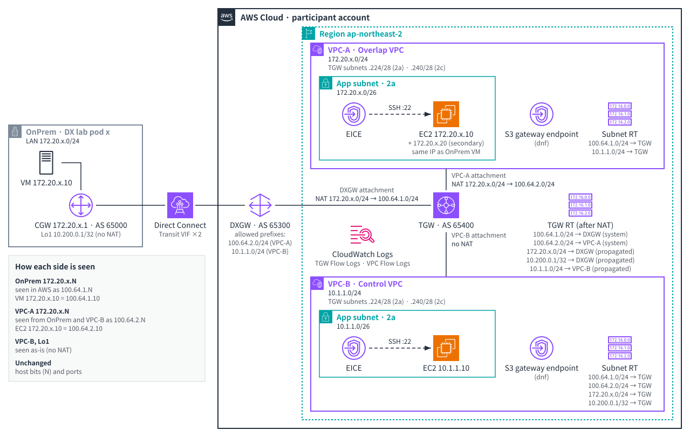

# 워크숍 계획: AWS Transit Gateway 1:1 NAT로 겹치는 온프레미스 대역 연결하기 (L200)

> 상태: **초안 3(콘솔 사전 테스트 반영)** · 작성 2026-11-03 · 근거: 사전 테스트(2026-11-03, ap-northeast-2, DX Lab Pod 1개), 콘솔 사전 테스트(2026-11-03, 사전 테스트 계정, Pod 89)

이 문서는 워크숍 콘텐츠를 쓰기 전에 목표, 과제, 진행 방식을 정하는 계획서입니다. 확정되면 이 계획에 따라 GitHub Pages 사이트를 만듭니다.

## 1. 개요

| 항목 | 내용 |
|---|---|
| 대상 | VPC, Transit Gateway, Direct Connect의 기본 개념을 아는 AWS 고객(네트워크·클라우드 엔지니어) |
| 레벨 | L200. 라우터 설정과 BGP 명령은 그대로 따라 할 수 있게 제공합니다 |
| 소요 시간 | **2시간: 강사 발표 1시간 + 실습 1시간**. 시간 안에 못 하는 내용은 사이트의 추가 과제로 둡니다 |
| 형식 | 참가자마다 독립된 Pod(라우터 VM, Linux VM)와 AWS 테스트 계정 1개(계정당 Pod 1개) |
| 콘솔 | 영어 콘솔 기준. 메뉴·버튼 이름은 영어 그대로 굵게 쓰고, 설명은 한국어로 씁니다 |
| 스크린샷 | 주요 화면마다 넣습니다. 계정 ID 등은 가립니다 |
| 템플릿 | 사이트에서 YAML을 내려받아 CloudFormation 콘솔에서 업로드합니다 |
| 게시 | GitHub Pages(공개 저장소 `aws-tgw-nat-l200`) |

## 2. 시나리오

온프레미스 LAN(`172.20.N.0/24`, N은 Pod 번호)과 AWS의 VPC-A가 **같은 대역**을 씁니다. 온프레미스는 Direct Connect(전송 가상 인터페이스 2개 → Direct Connect 게이트웨이 → Transit Gateway)로 AWS에 연결됩니다. 주소를 바꾸지 않고 둘을 통신시키기 위해 Transit Gateway 1:1 NAT로 **양쪽을 모두 번역**합니다. NAT를 걸지 않는 대조군 VPC-B(`10.1.1.0/24`)도 함께 둡니다.

구성도의 `x`는 참가자 Pod 번호(N)입니다. 워크숍 사이트에는 참가자 시점으로 다시 그린 구성도를 넣습니다.

| 위치 | 항목 | 값 |
|---|---|---|
| 온프레미스 Pod | LAN | `172.20.N.0/24`. 라우터 `.1`, Linux VM `.10` |
| | 라우터 BGP | ASN 65000, Loopback1 `10.200.0.1/32`(NAT 규칙에 걸리지 않는 출발지) |
| Direct Connect | 전송 가상 인터페이스 | 2개. VLAN은 참가자 정보 페이지와 hosted connection 상세 화면의 값을 그대로 씀. MTU 1500 |
| | Direct Connect 게이트웨이 | ASN 65300(Transit Gateway ASN과 달라야 함) |
| AWS | Transit Gateway | ASN 65400 |
| | VPC-A | `172.20.N.0/24`, EC2 `.10`(보조 IP `.20`) |
| | VPC-B(대조군) | `10.1.1.0/24`, EC2 `10.1.1.10` |
| NAT | 온프레미스 쪽 | `172.20.N.0/24` → `100.64.1.0/24`(DXGW 쪽 연결의 규칙) |
| | VPC-A 쪽 | `172.20.N.0/24` → `100.64.2.0/24`(VPC-A 쪽 연결의 규칙) |

## 3. 용어

영어 콘솔을 쓰므로 콘솔 이름과 한국어 설명을 다음처럼 짝지어 씁니다. 본문에서 "연결"만 단독으로 쓰지 않습니다.

| 콘솔(영어) | 본문 표기 |
|---|---|
| Hosted connection | hosted connection(호스팅 연결) |
| Transit virtual interface | 전송 가상 인터페이스(transit VIF) |
| Direct Connect gateway | Direct Connect 게이트웨이(DXGW) |
| Gateway association | 게이트웨이 연결(DXGW와 TGW 사이) |
| Transit gateway attachment | Transit Gateway 연결(attachment) |
| Allowed prefixes | 허용된 접두사 |

## 4. 학습 목표

워크숍을 마치면 참가자는 다음을 할 수 있습니다.

1. hosted connection을 수락하고, 전송 가상 인터페이스와 Direct Connect 게이트웨이를 만들어 Transit Gateway에 연결할 수 있습니다.
2. 온프레미스 라우터에서 BGP·BFD를 설정하고, 콘솔과 라우터 양쪽에서 세션과 경로를 확인할 수 있습니다.
3. 겹치는 CIDR이 Transit Gateway 라우팅에서 일으키는 문제를 재현하고, 라우팅 테이블에서 원인을 찾을 수 있습니다.
4. 콘솔에서 두 Transit Gateway 연결(DXGW 쪽, VPC-A 쪽)에 1:1 NAT 규칙을 설정하고 `system` 경로를 확인할 수 있습니다.
5. 양쪽 끝에서 상대가 어떤 주소로 보이는지 확인하고, 1:1 매핑(호스트 비트·포트 유지)을 설명할 수 있습니다.
6. NAT System Route Support의 두 모드와 온프레미스 광고의 관계, 운영 시 주의할 점을 설명할 수 있습니다(발표, 추가 과제).
7. CloudWatch 지표와 Flow Logs로 NAT 동작을 관측할 수 있습니다(발표, 추가 과제).

## 5. 진행 원칙

- **CloudFormation은 바탕만 깝니다.** VPC 2개, 서브넷, VPC 라우팅 테이블, 보안 그룹, EC2 2대(응답 서버 포함), EC2 Instance Connect Endpoint, Transit Gateway와 VPC 쪽 Transit Gateway 연결 2개, Flow Logs를 스택 하나로 배포합니다.
- **핵심 동작은 모두 콘솔에서 직접 합니다.** hosted connection 수락, Direct Connect 게이트웨이, 전송 가상 인터페이스 2개, 게이트웨이 연결과 허용된 접두사, 1:1 NAT 설정(**Manage 1:1 NAT**), Transit Gateway 라우팅 테이블, CloudWatch, EC2 접속(**EC2 Instance Connect** → **Connect using EC2 Instance Connect Endpoint**).
- 라우터와 Linux VM은 DX Lab 포털의 웹 터미널로 접속합니다. 라우터 설정은 참가자 값을 채워 넣는 템플릿(`<POD>`, `<VLAN1>`, `<AWS_PEER1>`, `<BGP_KEY1>` 등)으로 제공하고, 각 값을 어디서 찾는지 표로 안내합니다.
- 오래 걸리는 프로비저닝은 발표 앞이나 다른 작업과 겹치게 배치합니다. 콘솔 사전 테스트 측정값(13절): hosted connection 수락 → `available` 약 3분, 스택 6분 17초, 게이트웨이 연결 약 3분, 전송 가상 인터페이스는 라우터 BGP 설정 후 약 3분 안에 `available`·BGP `up`, 1:1 NAT 저장 → `enabled` 약 13초.
- 과제마다 **확인 포인트**(무엇이 보이면 성공인지)와 **문제 해결 팁**을 둡니다. 실패처럼 보이지만 기대한 결과인 단계는 미리 알려 줍니다.
- 공식 문서 내용과 사전 테스트에서 관찰한 내용을 구분해 씁니다. 관찰한 내용에는 "사전 테스트에서 관찰(날짜, 조건)"을 붙입니다.

## 6. 진행표(2시간)

| 시간 | 구분 | 내용 |
|---|---|---|
| 0:00–0:10 | 실습 2-1 | 콘솔 로그인(ap-northeast-2), 웹 터미널로 라우터·VM 접속 확인, **hosted connection 2개 수락**, **스택 배포 시작** |
| 0:10–0:35 | 발표 1 | 시나리오, Direct Connect·DXGW·Transit Gateway 복습, 겹치는 대역 문제, 1:1 NAT 개념(SNAT·DNAT, 규칙, 상태 없는 번역) |
| 0:35–1:00 | 실습 2-2 | DXGW 생성, 게이트웨이 연결과 허용된 접두사(스택 완료 후 바로 시작), 전송 가상 인터페이스 2개, 라우터 BGP·BFD 설정, 세션·경로·기본 통신 확인 |
| 1:00–1:25 | 발표 2 | NAT 규칙과 라우팅(`system` 경로, 경로 우선순위), NAT System Route Support의 두 모드와 **주의 상자**(7절), 관측 방법(지표, Flow Logs) |
| 1:25–1:50 | 실습 2-3 | 겹치는 대역 문제 재현 → 1:1 NAT 적용 → 양방향 통신과 1:1 매핑 확인 |
| 1:50–2:00 | 발표 3 | 정리, 운영 팁, 리소스 정리 안내 |

## 7. 과제

### 7.1 시간 안에 하는 과제

| # | 과제 | 참가자가 하는 일 | 확인 포인트 | 시간 |
|---|---|---|---|---|
| 2-1 | 시작하기 | 참가자 정보 페이지에서 내 계정·Pod·hosted connection ID와 VLAN 확인, 콘솔 로그인, 웹 터미널 접속, hosted connection 2개 **Accept**, 템플릿 내려받기 → CloudFormation **Create stack**(Pod 번호 입력, IAM 리소스 생성 확인란 선택) | hosted connection `Pending`→`Available` 진행 중, 스택 `CREATE_IN_PROGRESS` | 10분 |
| 2-2-1~2-2-6 | Direct Connect 연결 | ① **Direct Connect gateways** → **Create Direct Connect gateway**(ASN 65300) ② 스택 완료 후 DXGW 상세 → **Gateway associations** → **Associate gateway**(Transit Gateway, 허용된 접두사 `100.64.2.0/24`, `10.1.1.0/24`) ③ hosted connection마다 **Virtual interfaces** → **Create virtual interface** → **Transit**(Connection 선택, DXGW 선택, VLAN은 자동으로 채워지고 바꿀 수 없음, BGP ASN 65000) ④ 전송 가상 인터페이스 상세의 **Peerings** 탭에서 Your router peer IP, Amazon router peer IP, BGP authentication key 확인 ⑤ 사이트의 라우터 설정 생성기에 값을 넣어 만든 설정을 라우터에 붙여 넣기 ⑥ **Accepted Routes**·**Advertised Routes** 탭으로 주고받은 경로 확인 | 전송 가상 인터페이스 `available`, BGP `up`(콘솔), 라우터 `show ip bgp summary`에서 두 세션 Established, `10.1.1.0/24`·`100.64.2.0/24` 수신 | 20분 |
| 2-2-6~2-2-7 | 기본 통신 | Transit Gateway 라우팅 테이블 확인, 라우터 Loopback1에서 VPC-B로 ping과 TCP 8080 | VPC-B 응답 서버가 `10.200.0.1`을 그대로 봄 | 5분 |
| 2-3-1~2-3-2 | 겹치는 대역 문제 재현 | 라우팅 테이블에서 `172.20.N.0/24`가 VPC-A만 가리키는 것 확인, VPC-A EC2에 **Connect** → **EC2 Instance Connect Endpoint**로 접속해 tcpdump, VM에서 VPC-B로 ping | VM → VPC-B ping 실패(기대한 결과), VPC-A EC2가 VPC-B의 응답을 받음 | 7분 |
| 2-3-3~2-3-6 | 1:1 NAT 적용 | **Transit gateway attachments** → DXGW 쪽 연결 → **1:1 NAT** 탭 → **Manage 1:1 NAT** → **Enable NAT Gateway support** 선택, **NAT system routes**는 선택된 채로 둠, **Add rule**(Rule number 100, Source CIDR `172.20.N.0/24`, NAT CIDR `100.64.1.0/24`) → **Save changes**. VPC-A 쪽 연결도 같은 방법(`100.64.2.0/24`, NAT system routes는 선택된 채 바꿀 수 없음) | 두 연결 모두 **Enabled**, 규칙 **Activated**(사전 테스트 시 약 13초). 라우팅 테이블에 `100.64.1.0/24`·`100.64.2.0/24` `system` 경로 | 7분 |
| 2-3-7 | 양방향 통신과 1:1 매핑 | VM → `100.64.2.10` `ping`·`curl`, 보조 IP(`100.64.2.20`) `ping`, 고정 출발지 포트(`curl --local-port 40000`). VM에서 `python3 -m http.server 8080`을 띄우고 VPC-A EC2 → `100.64.1.10` `ping`·`curl`. **(선택)** UDP: `(echo hello; sleep 1) \| nc -u -w 2 100.64.2.10 9000`(traditional `nc`와 ncat 모두 동작). 시간이 부족하면 강사가 UDP 단계를 생략 | VPC-A는 `100.64.1.10`, 온프레미스는 `100.64.2.10`으로 봄. 마지막 옥텟·포트 유지. UDP 응답도 `saw 100.64.1.10:<포트>` | 10분 |

실습 2-2는 25분 안에 2-2-1~2-2-7(25분), 실습 2-3은 2-3-1~2-3-7(24분)입니다. 2-3-7에서 만든 트래픽은 추가 과제 3-3의 지표·로그 관측에 다시 씁니다.

### 7.2 추가 과제(행사 뒤 각자, 사이트에 제공)

| # | 과제 | 내용 | 확인 포인트 |
|---|---|---|---|
| 3-1 | NAT 없는 VPC와 원래 경로 | VM ↔ VPC-B, VPC-B → 두 NAT 대역, VPC-B → 원래 주소 `172.20.N.10`, Loopback 출발지 | 목적지와 상관없이 SNAT. 원래 주소로 보내면 VPC-A가 아니라 온프레미스 VM에 도착(VM tcpdump), ping은 0/5·TCP는 시간 초과가 **기대한 결과**(VPC-B Flow Logs에 REJECT) |
| 3-2 | 경로 설치 옵션 | `enable`에서 라우터의 /24 광고를 멈춰 `system` 경로 `blackhole` 확인 → /16 요약 광고로 복구. `disable` 전환은 ① 라우터에서 `100.64.1.0/24`(Null0) 광고 추가 ② 라우팅 테이블에서 `system` 그대로인지 확인 ③ **Manage 1:1 NAT**에서 NAT system route support 끄기 ④ `propagated`로 바뀐 것 확인. 되돌리기는 ① 원래 대역 광고 유지 확인 ② 다시 켜기 ③ `100.64.1.0/24` 광고·Null0 삭제. **원래 대역 광고는 끝까지 유지**합니다(주의 상자) | blackhole과 복구, `disable`에서 `propagated` NAT 경로, 전환 중 손실 없음 |
| 3-3 | 관측 | CloudWatch에서 연결별 `PacketsInNAT`·`PacketsOutNAT`·폐기 지표, Logs Insights로 TGW Flow Logs와 VPC Flow Logs(`pkt-srcaddr`) 비교 | 번역이 일어난 연결마다 NAT 지표 증가(문서). TGW Flow Logs는 양 끝의 실제 주소를 기록(사전 테스트에서 관찰) |
| 3-4 | 정리 | 8절 순서대로 삭제 | 남은 리소스 없음 |

### 7.3 주의 상자: NAT System Route Support `disable`과 원래 대역 광고

- 문서: [Routing behavior for 1:1 NAT](https://docs.aws.amazon.com/vpc/latest/tgw/tgw-nat-routing.html)는 `disable`이면 온프레미스가 원래 CIDR을 광고할 필요가 없고, 원래 CIDR이 다른 연결의 CIDR과 겹치면 NAT CIDR을 광고한 뒤 원래 CIDR 광고를 멈추라고 설명합니다. 이 워크숍의 시나리오가 바로 그 경우입니다.
- 사전 테스트에서 관찰(2026-11-03, ap-northeast-2, Direct Connect 게이트웨이 연결, 50Mbps hosted connection 2개, 라우터 IOS XE 16.12, Pod 1개):
  - 원래 대역 광고를 멈추자 **AWS → 온프레미스 방향**이 끊겼습니다. 온프레미스 → AWS 방향은 전달됐습니다.
  - 다시 광고하자 2초 안에 복구됐습니다. 4번 반복해 4번 모두 같았고, 5분 넘게 유지해도 회복되지 않았습니다.
  - Transit Gateway는 패킷을 번역해 DXGW 쪽 연결로 내보냈지만(`PacketsOutNAT` 평소 수준), 라우터에는 도착하지 않았습니다(인바운드 ACL 카운터 0). 어디서 버려졌는지는 확인하지 못했습니다.
- 안내: 이 워크숍에서는 `disable`에서도 **원래 대역(또는 그것을 포함하는 요약 경로) 광고를 유지**합니다. 참가자가 원래 대역 광고를 멈추는 과제는 두지 않습니다(사용자 결정). 발표 2에서 강사가 설명하고, 사이트 부록 4-3에 ID를 뺀 증적 요약(손실 시간표, 카운터, 지표)을 둡니다.
- 게시 전에 AWS Support·문서 피드백으로 확인을 요청하고 결과를 이 상자에 적습니다. 행사 전마다 다시 확인합니다.

## 8. 정리 순서(추가 과제 3-4)

1. 두 Transit Gateway 연결의 1:1 NAT를 끕니다(규칙은 남아도 됨).
2. DXGW의 게이트웨이 연결을 지우고 `disassociated`가 될 때까지 기다립니다. DXGW 쪽 Transit Gateway 연결이 남아 있으면 Transit Gateway를 지울 수 없습니다.
3. 전송 가상 인터페이스 2개를 지운 뒤 DXGW를 지웁니다.
4. CloudFormation 스택을 지웁니다. 워크숍 템플릿의 로그 그룹은 스택과 함께 지워지게 합니다(Retain 쓰지 않음).
5. 라우터에 추가한 설정은 그대로 두어도 됩니다(운영자가 Pod를 복원).
6. **hosted connection은 지우지 않습니다.** 콘솔에서 지울 수 있지만, 운영자가 회수합니다.

삭제 대기(게이트웨이 연결 해제, 전송 가상 인터페이스 삭제)에 몇 분씩 걸리므로 약 15분을 안내합니다. 사전 테스트에서 잽니다.

## 9. CloudFormation 스택(참가자 계정)

| 리소스 | 내용 |
|---|---|
| 파라미터 | Pod 번호 N(유효한 Pod 범위로 제한, → VPC-A `172.20.N.0/24`), NAT 대역 2개(기본 `100.64.1.0/24`, `100.64.2.0/24`) |
| Transit Gateway | ASN 65400, 기본 라우팅 테이블 연결·전파 켬 |
| VPC-A | `172.20.N.0/24`. 앱 서브넷 `/26`, TGW 서브넷 `/28` 2개(2a, 2c). EC2 `172.20.N.10`(보조 IP `.20`). 라우팅 테이블에 `100.64.1.0/24`, `10.1.1.0/24` → TGW |
| VPC-B | `10.1.1.0/24`. 같은 구조, EC2 `10.1.1.10`. 라우팅 테이블에 `100.64.1.0/24`, `100.64.2.0/24`, `172.20.N.0/24`, `10.200.0.1/32` → TGW |
| EC2 | t4g.micro AL2023 2대, 응답 서버(TCP 8080은 본 클라이언트 주소를 돌려줌, UDP 9000은 본 주소를 붙여 에코), tcpdump·ncat |
| 접속 | VPC마다 EICE 1개, SSH는 EICE 보안 그룹에서만, 공인 IP 없음. EICE 터널은 최대 1시간 |
| dnf | S3 gateway endpoint(AL2023 저장소만 허용) |
| 로그 | TGW Flow Logs, VPC Flow Logs(`pkt-srcaddr`·`pkt-dstaddr` 포함, 집계 60초) → CloudWatch Logs(스택과 함께 삭제), 전송용 IAM 역할 |

- 사전 테스트에 쓴 템플릿을 바탕으로 만들고, 계정 ID·내부 이름·비공개 저장소 참조는 넣지 않습니다.
- VPC 라우팅 테이블과 보안 그룹은 NAT 대역을 미리 포함합니다. 실습 2-3에서 이유를 설명합니다(상대가 NAT 대역으로 보이므로).
- 허용된 접두사에 VPC-A의 실제 대역을 넣지 않는 이유를 2-2-2에서 설명합니다(온프레미스 LAN과 같은 대역이고, 허용된 접두사는 적은 그대로 온프레미스에 광고됨).

## 10. 사이트 구성

- MkDocs Material, GitHub Actions로 GitHub Pages(`https://ws.nettfc.net/aws-tgw-nat-l200/`)에 게시합니다.
- 페이지: 1. 시작하기 전에(1-1 소개: 시나리오·구성도·목표·진행표, 1-2 사전 준비, 1-3 용어 풀이) → 2. 실습(2-1~2-3) → 3. 추가 과제(3-1~3-4) → 4. 부록(4-1~4-5: 라우터 설정 템플릿, 값 찾는 곳, 문제 해결, 1:1 NAT 개념과 제약 요약, 주의 상자 증적 요약, 참고 문서).
- 구성도는 skill-aws-arch-diagram(공식 AWS 아이콘)으로 그립니다. 흐름을 ASCII 그림으로 그리지 않습니다.
- 스크린샷은 사전 테스트 계정의 영어 콘솔에서 찍고 계정 ID를 가립니다.
- 문제 해결 팁(예): hosted connection에는 VIF를 하나만 만들 수 있으므로 잘못 만든 VIF는 지우고 다시 만듦, VLAN은 hosted connection 값과 같아야 함, BGP 키·주소 오타, MTU 1500 유지, 라우터의 LAN·관리 인터페이스는 웹 터미널 경로이므로 건드리지 않음.

## 11. 사전 준비와 위험

| 항목 | 내용 |
|---|---|
| 참가자 배정 | 워크숍 운영자가 Pod와 AWS 계정을 할당하면 hosted connection 2개가 그 계정에 주문 상태(`Ordering`)로 생깁니다. 참가자는 참가자 정보 페이지에서 자기 값(계정, Pod, 웹 터미널 링크, hosted connection ID와 VLAN)을 찾습니다. 리전(ap-northeast-2)은 사이트에 적습니다 |
| 계정 | 계정당 Pod 1개. 시작 전에 남은 EICE·Transit Gateway가 없어야 합니다(EICE는 계정·리전당 5개, 조정 불가, 스택이 2개 씀) |
| 권한 | 참가자 계정의 콘솔 사용자에게 필요한 권한(SCP가 막지 않는지도 확인): Direct Connect(`ConfirmConnection`, `CreateDirectConnectGateway`, `CreateTransitVirtualInterface`, 게이트웨이 연결 생성·수정·삭제, 삭제 작업들), EC2·VPC(`ModifyTransitGatewayAttachmentNatConfiguration`, `GetTransitGatewayAttachmentNatConfiguration`(`Describe*`에 포함되지 않음), `CreateInstanceConnectEndpoint`), `iam:CreateServiceLinkedRole`(EICE), `ec2-instance-connect:OpenTunnel`·`SendSSHPublicKey`, CloudFormation과 `iam:CreateRole`·`PassRole`, CloudWatch·`logs:StartQuery` |
| 비용 | hosted connection 2개의 포트 시간 요금(수락한 때부터 운영자가 회수할 때까지 수락한 계정에 청구), DX 데이터 전송, TGW 연결 3개의 시간당 요금과 데이터 처리, EC2 2대, CloudWatch Logs 수집·Logs Insights 쿼리. 1:1 NAT 기능 요금은 아직 요금 페이지에서 확인하지 못했으며 게시 전에 확인합니다 |
| 리전 | ap-northeast-2. 1:1 NAT는 모든 상용 리전에서 제공(출시 공지). 행사 전에 다시 확인합니다 |
| Linux VM | Pod VM에 기본으로 있는 도구만 씁니다: `ping`, `curl`, `python3`(`-m http.server`로 접속한 상대 주소 확인), `nc`(traditional, UDP 선택 단계), `tcpdump`. VM이 UDP를 받는 쪽일 때는 `nc`가 상대 주소를 보여 주지 않으므로 `tcpdump`로 봅니다. 사전 테스트 때 Pod의 apt 프록시에 연결되지 않아 ncat을 설치할 수 없었으므로 추가 설치에 의존하지 않습니다 |
| 라우터 | LAN 인터페이스만 설정된 상태에서 시작합니다(운영자가 복원). 참가자가 VIF 서브인터페이스, BFD, BGP, Loopback1을 추가합니다 |
| 시계 | 라우터와 VM의 시계는 NTP로 맞춰져 있지 않을 수 있습니다. 시각 비교는 AWS 쪽 기록을 기준으로 안내합니다 |
| 콘솔 절차 검증 | 실습 2-1~2-3, 추가 과제 3-1~3-4(정리 포함)를 사전 테스트 계정의 영어 콘솔로 사전 테스트했습니다(13절) |
| hosted connection 대기 | 사전 테스트에서는 수락 후 약 3분 만에 `available`이 됐습니다. 행사 규모에서도 같은지는 확인하지 못했습니다 |

## 12. 결정 사항

**결정됨(2026-11-03)**
- 레벨 L200, 원래 대역 철회는 과제로 두지 않고 주의 상자 설명만, 템플릿은 내려받아 업로드, 콘솔 스크린샷 포함, 영어 콘솔, 2시간(발표 1시간 + 실습 1시간)

**결정이 필요한 항목**
1. 고객 워크숍에서 쓸 Pod 모드(모드에 따라 VLAN 대역이 다름)
2. 참가자 AWS 계정의 소유와 비용 부담(hosted connection 포트 요금은 수락할 때부터 청구)
3. hosted connection 수락 시점: 행사 당일 실습 2-1 / 전날 참가자에게 미리 수락 안내
4. 참가자 콘솔 로그인 방법(계정 자격 증명 전달 방식)
5. Linux VM 준비: 기본 도구만 쓰는 방식으로 바꿈(제안). Pod 이미지를 바꿀 필요가 없는지 확인
7. 주의 상자 내용의 AWS 확인 요청 여부와 담당
8. 콘솔 사전 테스트 일정(사전 테스트 계정 전달 후)

## 13. 콘솔 사전 테스트 결과(2026-11-03, 사전 테스트 계정, Pod 89)

| 단계 | 측정(UTC) | 콘솔에서 확인한 내용 |
|---|---|---|
| hosted connection 수락 | 07:34:58·07:35:04 수락 → 07:37:49 두 연결 `available` | 목록의 **Accept hosted connection** |
| 스택 배포 | 07:40:11 → 07:46:28(6분 17초, EICE가 가장 오래 걸림) | IAM 확인란은 3단계(**Configure stack options**) 아래 **Capabilities**에 있음 |
| DXGW 생성 | 몇 초 | **Create Direct Connect gateway**는 링크 형태 |
| 전송 가상 인터페이스 | 07:48경 생성 → 라우터 설정(07:53) 후 07:55:58 둘 다 `available`·BGP `up` | VLAN은 자동으로 채워지고 바꿀 수 없음. **Peerings** 탭에 피어 IP와 BGP 키. **Actions** → **Sample configuration**은 Cisco 2900/3700/7200(IOS 12.4+)·Nexus만 있어 인터페이스 이름과 `network` 문을 고쳐야 함 → 사이트에서 값만 넣는 설정 생성기를 제공 |
| 게이트웨이 연결 | 07:51경 제출 → 07:54:47 `associated`(약 3분) | DXGW 목록의 링크는 이름이 아니라 ID로 표시됨 |
| 기본 통신 | Loopback1 → VPC-B ping 5/5, `vpc-b-ec2 saw 10.200.0.1` | — |
| 문제 재현 | VM → VPC-B ping 0/8, VPC-A EC2 tcpdump에 VPC-B의 응답 8개 | **Connect** → **In web browser** → **EC2 Instance Connect Endpoint** 카드 → **Connect**는 같은 탭에서 터미널을 엶 |
| 1:1 NAT | DXGW 쪽 08:20:08 저장 → 08:20:21 `enabled`, VPC-A 쪽 08:22:05 → 08:22:19 | 탭 이름은 **1:1 NAT - new**, 폼 제목은 **Manage NAT rules**. VPC 연결은 **NAT system routes**가 선택된 채 잠김. 빈 규칙 행이 있으면 저장되지 않음(**Remove**로 지움) |
| 라우팅 테이블 | `100.64.1.0/24`(DXGW)·`100.64.2.0/24`(VPC) **System**, `172.20.89.0/24`는 DXGW Propagated | Routes 탭의 **Route type** 열 |
| 양방향·1:1 | VM → VPC-A ping 5/5, `saw 100.64.1.10:42306`, UDP `saw 100.64.1.10:33792`, `.20` 3/3, `:40000` 유지. VPC-A → VM ping 4/4, VM `http.server` 로그에 `100.64.2.10` | VM은 기본 도구만 사용 |
| 정리(추가 과제 3-4) | 09:47:22 시작 → 09:59:57 스택 삭제 완료(약 13분). NAT 끄기 약 1분, 게이트웨이 연결 끊기 약 2분, VIF 삭제 약 3분, DXGW 즉시, 스택 약 2.5분 | 스택 삭제 확인 창에 스택 이름 입력 필요. 끝난 뒤 hosted connection 2개는 Available로 남음 |

## 참고

- [1:1 NAT in AWS Transit Gateway](https://docs.aws.amazon.com/vpc/latest/tgw/tgw-nat.html)
- [How 1:1 NAT works](https://docs.aws.amazon.com/vpc/latest/tgw/tgw-nat-how-it-works.html)
- [Routing behavior for 1:1 NAT](https://docs.aws.amazon.com/vpc/latest/tgw/tgw-nat-routing.html)
- [Configure 1:1 NAT](https://docs.aws.amazon.com/vpc/latest/tgw/tgw-nat-configure.html)
- [Hosted Direct Connect connections](https://docs.aws.amazon.com/directconnect/latest/UserGuide/hosted_connection.html)
- [Allowed prefixes](https://docs.aws.amazon.com/directconnect/latest/UserGuide/allowed-to-prefixes.html)
