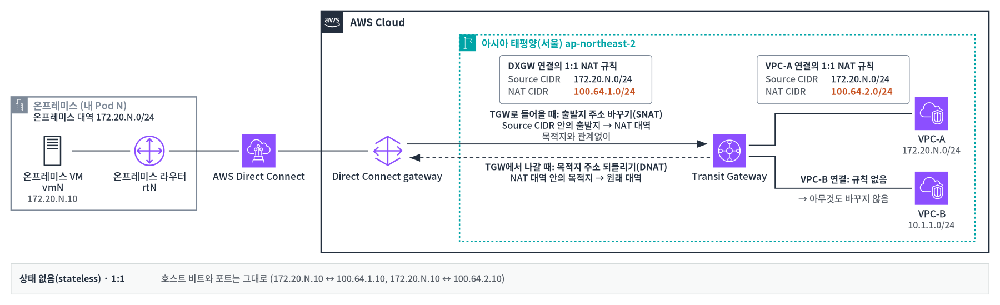

# 4-2. 1:1 NAT 개념과 제약

공식 문서([1:1 NAT](https://docs.aws.amazon.com/vpc/latest/tgw/tgw-nat.html), [How it works](https://docs.aws.amazon.com/vpc/latest/tgw/tgw-nat-how-it-works.html), [Routing](https://docs.aws.amazon.com/vpc/latest/tgw/tgw-nat-routing.html), [Configure](https://docs.aws.amazon.com/vpc/latest/tgw/tgw-nat-configure.html))를 바탕으로 쉽게 정리했습니다.

**상태 없음(stateless) · 1:1**: 호스트 비트와 포트는 그대로입니다(`172.20.N.10` ↔ `100.64.1.10`, `172.20.N.10` ↔ `100.64.2.10`).

## 4-2-1. 어떻게 동작하나 { #how }

| 항목 | 설명 |
|---|---|
| 바꾸는 방식 | 대역을 대역으로 한 주소씩 짝지어 바꿉니다. 마지막 부분(호스트 비트)과 포트는 그대로입니다. IPv4만 됩니다 |
| 규칙 위치 | Transit Gateway 연결마다 둡니다. 규칙 하나가 양쪽 방향을 모두 처리합니다 |
| 들어올 때 | 보낸 쪽 주소가 규칙의 원래 대역(Source CIDR)에 있으면 NAT 대역으로 바꿉니다. 목적지는 따지지 않습니다 |
| 나갈 때 | 받는 쪽 주소가 NAT 대역에 있으면 원래 주소로 되돌립니다 |
| 상태 없음 | 연결을 기억하지 않습니다. 그래서 어느 쪽에서 먼저 보내도 똑같이 동작합니다 |
| 적용 중 | 바꾸는 동안에도 연결은 **available** 상태를 유지합니다. NAT 상태는 enabling → enabled, 규칙은 activated가 됩니다 |
| VPC 연결의 경로 | 규칙의 원래 대역이 VPC 대역과 똑같으면, VPC의 경로가 NAT 대역의 **System** 경로로 바뀝니다. NAT system routes는 항상 켜져 있습니다 |
| DXGW 연결의 경로 | NAT system routes를 켜면(기본값) Transit Gateway가 NAT 대역 경로를 만듭니다. 끄면 온프레미스가 광고합니다([추가 과제 3-2](extra-b.md)) |
| 경로 우선순위 | 같은 대역이면 static > system > prefix list > propagated 순서로 쓰입니다 |
| 지표 | `PacketsInNAT`(들어올 때 바꾼 수), `PacketsOutNAT`(나갈 때 되돌린 수). 규칙이 쓰인 연결에 기록됩니다 |

## 4-2-2. 지켜야 할 조건 { #limits }

| 조건 | 내용 |
|---|---|
| 대역 크기 | 원래 대역과 NAT 대역의 크기(예: /24)가 같아야 합니다 |
| NAT 대역 | 사설 주소(RFC 1918) 또는 `100.64.0.0/10`만 쓸 수 있습니다 |
| 원래 대역 | 멀티캐스트(224.0.0.0/4), 링크 로컬(169.254.0.0/16)은 안 됩니다 |
| 같은 연결 안 | 규칙끼리 대역이 겹치면 안 됩니다 |
| 다른 연결 사이 | 겹쳐도 **검사하지 않습니다**. NAT 대역은 사람이 따로 관리해야 합니다 |
| 규칙 없이 켜기 | 안 됩니다. 끌 때는 규칙을 남긴 채 NAT Gateway support만 끕니다 |
| appliance mode | appliance mode가 켜진 VPC 연결에는 NAT를 켤 수 없습니다 |
| 안 되는 연결 | Cloud WAN peering·route table 연결, Network Function, Client VPN |
| 바꾸는 중 | enabling·disabling 중에는 다시 바꿀 수 없습니다 |
| 한도 | 연결당 규칙 50개, Transit Gateway당 1,000개 |
| 권한 | `ec2:ModifyTransitGatewayAttachmentNatConfiguration`, `ec2:GetTransitGatewayAttachmentNatConfiguration`(`Describe*` 권한에 들어 있지 않음) |

## 4-2-3. 바꾸거나 끌 때 { #change }

- 저장하면 화면의 규칙 목록 전체가 기존 규칙을 대신합니다. 지운 규칙은 잠시 deleting으로 보일 수 있습니다.
- 끄면 주소 바꾸기가 멈추고 규칙은 deactivated로 남습니다. 다시 켜면 activated가 됩니다.
- 켜고 끄거나 규칙을 바꿀 때 잠깐 패킷이 버려질 수 있습니다. 문서는 유지 보수 시간에 바꾸고, 상대가 쓰는 주소는 변경이 끝난 뒤에 바꾸라고 권합니다.
- VPC 연결에서 켜면 그 VPC의 실제 주소로 접근하던 다른 네트워크는 끊깁니다. 상대 쪽 설정은 미리 준비해 둡니다. 그리고 **NAT Gateway support: Enabled**와 규칙 상태 **Activated**를 확인한 뒤에 상대가 NAT 주소를 쓰게 바꿉니다.

## 4-2-4. 설계할 때 생각할 점 { #design }

- **DNS**: 1:1 NAT는 패킷의 주소만 바꿉니다. 그래서 DNS가 알려 주는 주소는 실제 주소 그대로입니다. 상대가 이름으로 접근하려면 NAT 주소용 DNS 레코드를 따로 두어야 합니다(추론, 문서에서 DNS 설명은 찾지 못함).
- **원래 경로**: NAT 뒤에도 온프레미스가 광고한 원래 경로는 Transit Gateway에 남습니다([3-1-3](extra-a.md#a3)).
- **UDP**: 사전 테스트에서 UDP도 TCP, ICMP와 같은 방식으로 바뀌는 것을 확인했습니다.
- **pending 상태**: 문서에 나오지 않지만, 사전 테스트에서 규칙을 처음 저장한 직후 API 응답에 잠시 pending이 보였습니다. 콘솔에서는 바로 activated로 보였습니다.
