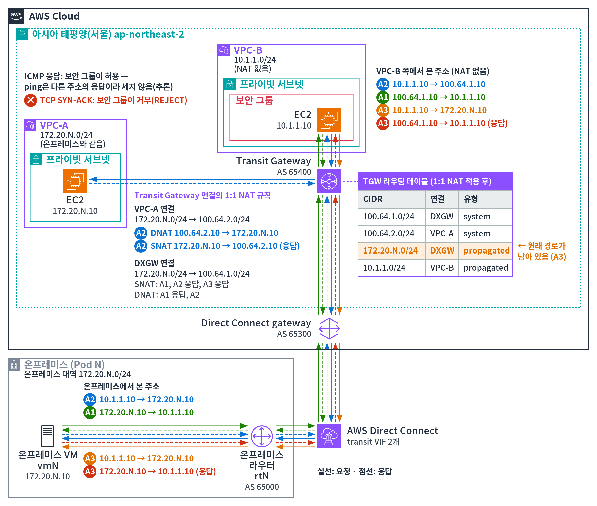
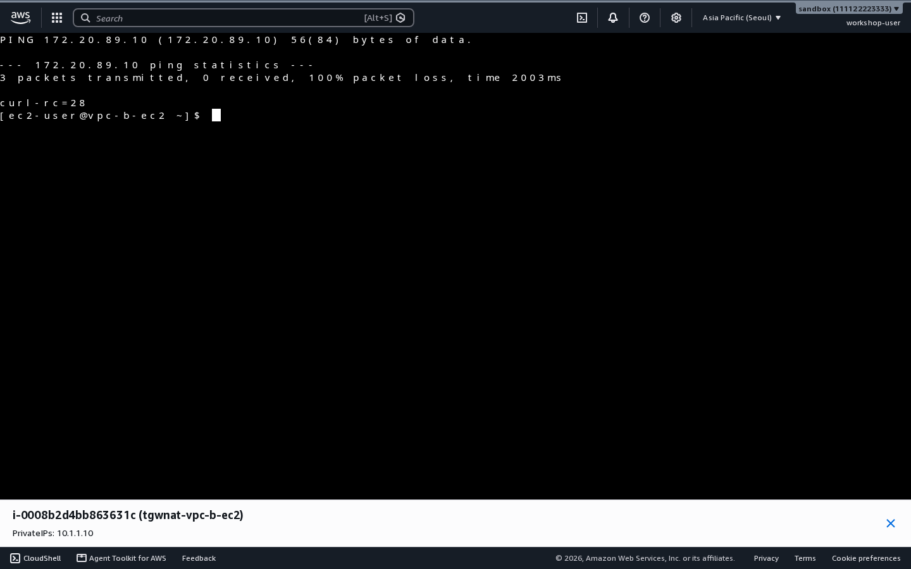

# 추가 과제 A. NAT가 없는 VPC-B와 원래 경로

NAT 규칙이 없는 VPC-B와 통신할 때 주소가 어떻게 보이는지 봅니다. 그리고 NAT 뒤에도 남아 있는 원래 경로 때문에 생기는 일을 확인합니다. [실습 2](lab2.md)를 마친 뒤에 합니다.



## A-1. 온프레미스 → VPC-B { #a1 }

온프레미스 VM(`vmN`) 터미널에서 실행합니다.

```bash
curl http://10.1.1.10:8080/
```

**결과**: `vpc-b-ec2 saw 100.64.1.10:<포트>`입니다.

VPC-B에는 NAT 규칙이 없습니다. 하지만 DXGW 연결로 **들어오는** 패킷은 목적지와 상관없이 출발지 주소가 바뀝니다. 그래서 실습 2의 [문제 확인](lab2.md#lab2-2)에서 VPC-A로 잘못 가던 응답이 이제 온프레미스 VM으로 돌아옵니다.

## A-2. VPC-B → NAT 주소 { #a2 }

1. 온프레미스 VM(`vmN`) 터미널에서 웹 서버를 백그라운드로 실행합니다: `python3 -m http.server 8080 &`
2. VPC-B EC2(`tgwnat-vpc-b-ec2`)에 [실습 2-1](lab2.md#lab2-1)처럼 접속해 실행합니다.

    ```bash
    curl -s -o /dev/null -w 'HTTP %{http_code}\n' http://100.64.1.10:8080/
    curl http://100.64.2.10:8080/
    ```

**결과**

- 둘 다 성공합니다.
- VPC-A의 응답은 `vpc-a-ec2 saw 10.1.1.10:<포트>`입니다. 온프레미스 VM 웹 서버 기록의 맨 앞 주소도 `10.1.1.10`입니다.
- VPC-B는 NAT가 없으니 출발지 주소가 그대로입니다. 받는 쪽 연결에서 목적지 주소만 되돌립니다.

## A-3. VPC-B → 원래 주소 `172.20.N.10` { #a3 }

A-2에서 백그라운드로 실행한 온프레미스 VM의 웹 서버는 그대로 둡니다.

1. 온프레미스 VM(`vmN`) 터미널에서 패킷을 지켜봅니다.

    ```bash
    sudo tcpdump -ni ens192 'icmp or tcp port 8080'
    ```

2. VPC-B EC2 터미널에서 원래 주소로 보냅니다.

    ```bash
    ping -c 3 -W 1 172.20.N.10
    curl -s -m 5 http://172.20.N.10:8080/; echo "curl-rc=$?"
    ```

{ .shot }

**결과(실패처럼 보이지만 맞습니다)**

- VPC-B에서는 ping이 0/3, curl이 시간 초과(`curl-rc=28`)입니다.
- 그런데 온프레미스 VM의 tcpdump에는 `10.1.1.10 > 172.20.N.10` 요청이 **도착**하고, 응답도 나갑니다.

**왜 그럴까요?**

- NAT 뒤에도 라우팅 테이블에 온프레미스의 원래 경로 `172.20.N.0/24`가 남아 있습니다([실습 2-6](lab2.md#lab2-6)). 그래서 원래 주소로 보내면 VPC-A가 아니라 **온프레미스**로 갑니다.
- 온프레미스 VM의 응답은 DXGW 연결을 지나며 출발지가 `100.64.1.10`으로 바뀝니다.
- VPC-B 입장에서는 보낸 적 없는 주소에서 응답이 온 셈입니다.
- ping 응답은 VPC-B EC2까지 도착합니다(보안 그룹이 `100.64.1.0/24`의 ICMP를 허용). 하지만 보낸 주소와 다른 주소에서 온 응답이라 ping이 성공으로 세지 않은 것으로 보입니다(추론).
- TCP 응답(SYN-ACK)은 VPC-B 보안 그룹이 거부합니다. 사전 테스트(2026-11-03)에서 VPC Flow Logs의 **REJECT** 기록으로 확인했습니다.

!!! warning "실제 환경에서 주의할 점"
    NAT를 건 VPC의 원래 주소로는 다른 네트워크가 보내지 않게 하세요. 의도하지 않은 곳(이 실습에서는 온프레미스)으로 갈 수 있습니다.

끝나면 tcpdump는 **Ctrl+C**, 백그라운드로 실행한 온프레미스 VM의 웹 서버는 `kill %1`로 멈춥니다.

## A-4. 규칙에 없는 출발지 { #a4 }

온프레미스 라우터(`rtN`) 터미널에서 Loopback1(`10.200.0.1`)을 출발지로 VPC-B에 보냅니다.

```text
telnet 10.1.1.10 8080 /source-interface Loopback1
```

`GET / HTTP/1.0`을 입력하고 Enter를 두 번 누릅니다.

**결과**: `vpc-b-ec2 saw 10.200.0.1:<포트>`입니다. 규칙의 원래 대역(`172.20.N.0/24`)에 없는 주소는 바뀌지 않습니다.
