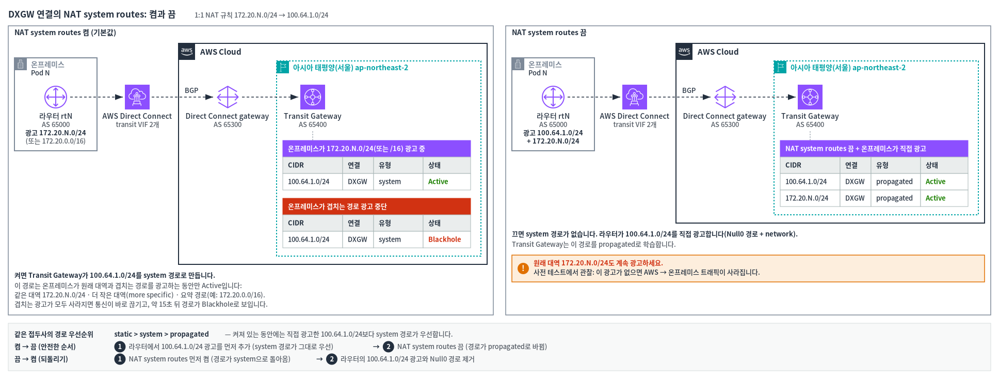
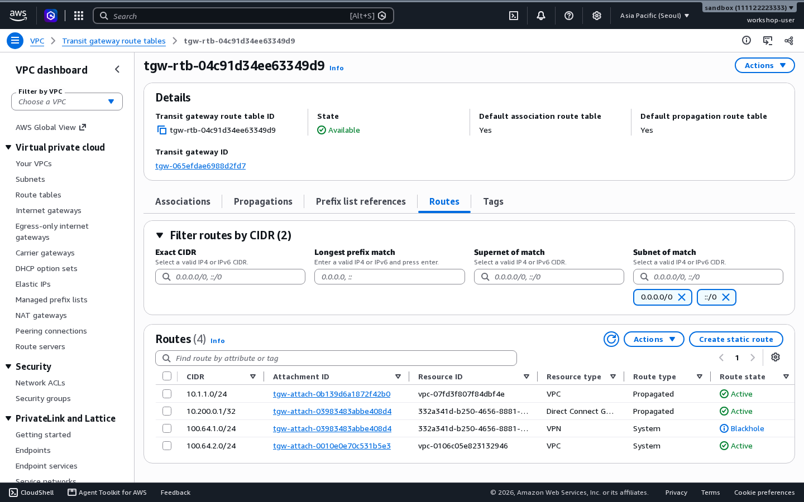
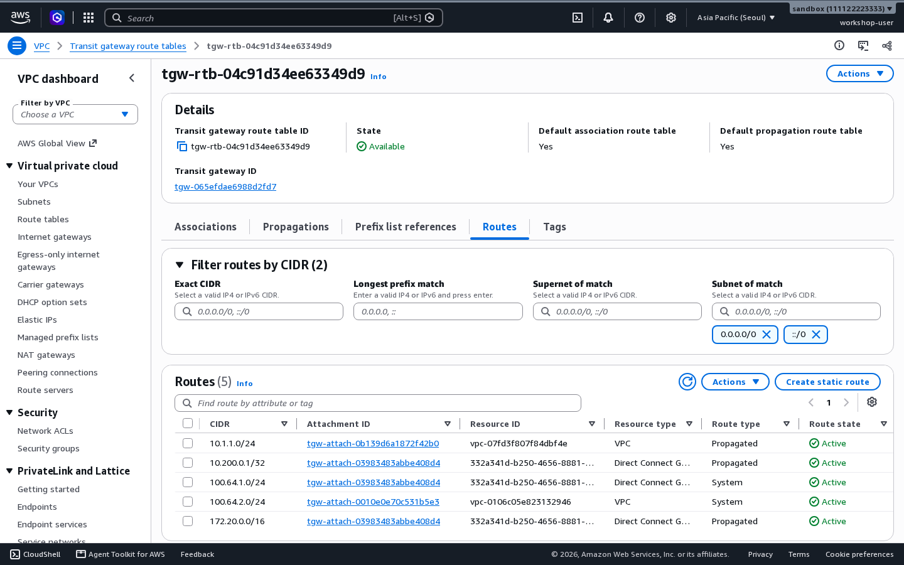
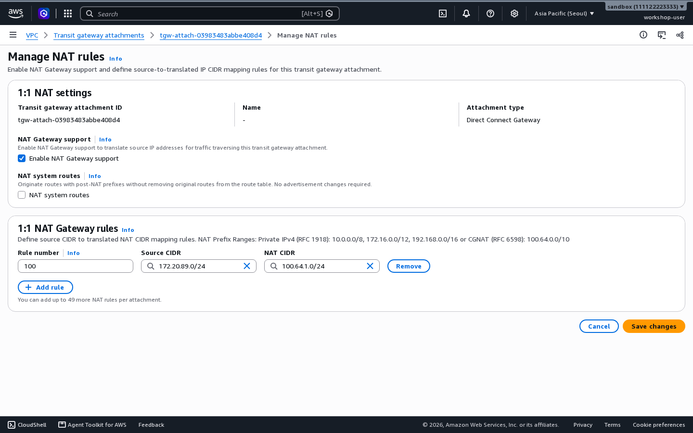
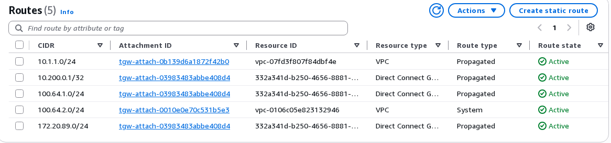

# 추가 과제 B. NAT 경로 설정(NAT system routes)

DXGW 연결에는 **NAT system routes** 설정이 있습니다. NAT 대역(`100.64.1.0/24`)의 경로를 누가 만드는지 정합니다.

- **켬(기본값)**: Transit Gateway가 경로를 만듭니다.
- **끔**: 온프레미스 라우터가 BGP로 직접 광고합니다.

두 경우가 라우터의 광고와 어떻게 이어지는지 확인합니다.



## B-1. 켜져 있을 때 { #b1 }

켜져 있으면 `100.64.1.0/24` 경로(**System**)는 온프레미스가 원래 대역과 겹치는 경로를 광고하는 동안만 **Active**입니다. 겹치는 경로란 같은 대역(`172.20.N.0/24`), 그 안의 더 좁은 대역(예: `172.20.N.0/25`), 그것을 포함하는 넓은 대역(예: `172.20.0.0/16`, 요약 경로)을 말합니다. 광고가 없으면 **Blackhole**이 됩니다.

이 과제에서는 Blackhole을 보기 위해 원래 대역 광고를 **잠시** 멈춥니다.

1. 라우터에서 `172.20.N.0/24` 광고를 멈춥니다.

    ```text
    configure terminal
    router bgp 65000
     address-family ipv4
      no network 172.20.N.0 mask 255.255.255.0
    end
    ```

2. 라우팅 테이블을 새로 고칩니다. 통신은 바로 끊기고, 약 15초 뒤 `100.64.1.0/24`가 **Blackhole**로 보입니다.

    { .shot }

    Blackhole일 때 **Resource type**이 **VPN**으로 보이기도 하지만, 같은 DXGW 연결의 경로입니다.

3. 이번에는 넓은 대역 `172.20.0.0/16`을 광고합니다(요약 경로). 명령의 `Null0` 경로는 BGP로 광고하려고 만드는 경로이고, 실제 패킷은 이 경로로 보내지 않습니다.

    ```text
    configure terminal
    ip route 172.20.0.0 255.255.0.0 Null0
    router bgp 65000
     address-family ipv4
      network 172.20.0.0 mask 255.255.0.0
    end
    ```

4. 약 15초 뒤 `100.64.1.0/24`가 다시 **Active**가 되고 통신이 돌아옵니다. 요약 경로도 겹치는 경로로 인정됩니다.

    { .shot }

5. 원래대로 되돌립니다.

    ```text
    configure terminal
    router bgp 65000
     address-family ipv4
      network 172.20.N.0 mask 255.255.255.0
      no network 172.20.0.0 mask 255.255.0.0
     exit
    exit
    no ip route 172.20.0.0 255.255.0.0 Null0
    end
    ```

## B-2. 끌 때 { #b2 }

끄면 Transit Gateway는 NAT 대역 경로를 만들지 않습니다. 라우터가 `100.64.1.0/24`를 직접 광고해야 합니다. **순서가 중요합니다.** 광고를 먼저 추가하고 끕니다.

!!! warning "원래 대역 광고는 계속 유지하세요"
    끈 상태에서도 라우터의 `172.20.N.0/24` 광고는 그대로 둡니다. 문서는 끈 경우 원래 대역을 광고할 필요가 없다고 설명하지만, 사전 테스트에서는 원래 대역 광고를 멈추자 통신이 끊겼습니다. 자세한 내용은 [사전 테스트에서 관찰한 동작](observed.md)에 있습니다.

1. 라우터에서 `100.64.1.0/24` 광고를 추가합니다. 여기서도 `Null0` 경로는 광고용입니다.

    ```text
    configure terminal
    ip route 100.64.1.0 255.255.255.0 Null0
    router bgp 65000
     address-family ipv4
      network 100.64.1.0 mask 255.255.255.0
    end
    ```

2. 라우팅 테이블에서 `100.64.1.0/24`가 아직 **System**인지 봅니다. 같은 대역이면 System 경로가 먼저 쓰입니다.
3. DXGW 연결의 **Manage 1:1 NAT**에서 **NAT system routes**를 해제하고 **Save changes**를 누릅니다.

    { .shot }

4. 약 10초 뒤 `100.64.1.0/24`가 **Propagated**로 바뀝니다. 통신은 그대로 됩니다.

    { .shot }

5. 되돌립니다. 이번에도 순서를 지킵니다.
    1. **NAT system routes**를 다시 선택하고 저장합니다. 경로가 **System**으로 돌아왔는지 봅니다.
    2. 라우터의 `100.64.1.0/24` 광고와 Null0 경로를 지웁니다.

    ```text
    configure terminal
    router bgp 65000
     address-family ipv4
      no network 100.64.1.0 mask 255.255.255.0
     exit
    exit
    no ip route 100.64.1.0 255.255.255.0 Null0
    end
    ```

## 언제 끄나요 { #when }

| 설정 | NAT 대역 경로 | 라우터가 할 일 |
|---|---|---|
| 켬(기본값) | Transit Gateway가 **System** 경로로 만듦 | 원래 대역과 겹치는 경로를 계속 광고 |
| 끔 | 만들지 않음 | NAT 대역을 직접 광고. 사전 테스트에서는 원래 대역 광고도 계속 필요했음 |

문서에 따르면 끄는 것은 광고 내용을 직접 정하고 싶을 때입니다. 예를 들어 피어마다 더 작은 대역을 광고하거나, 한쪽을 대기용으로 두려고 AS-path를 늘리거나(AS-path prepending), 두 경로를 똑같이 쓰려고(ECMP) 속성을 맞추는 경우입니다.
