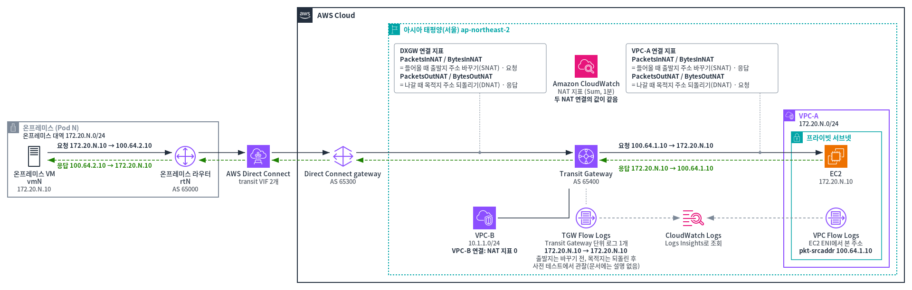
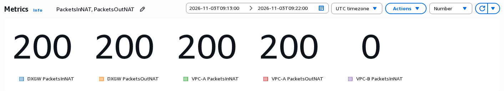
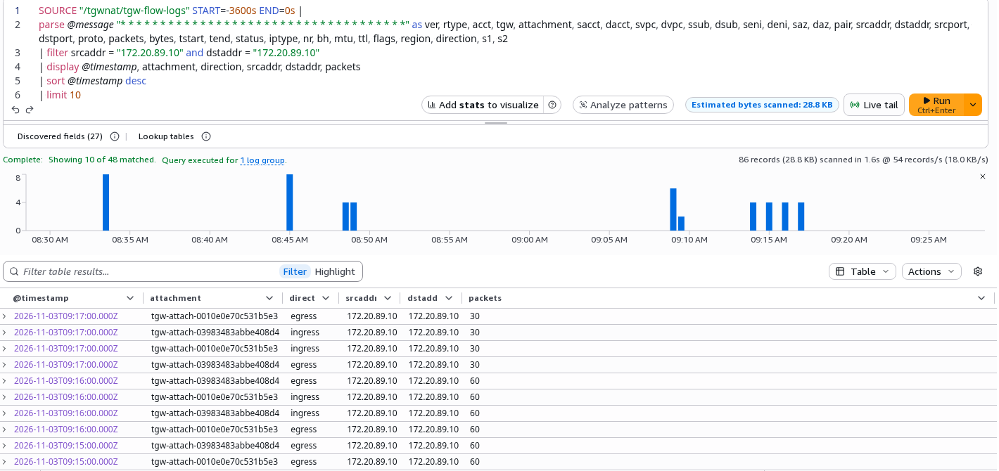
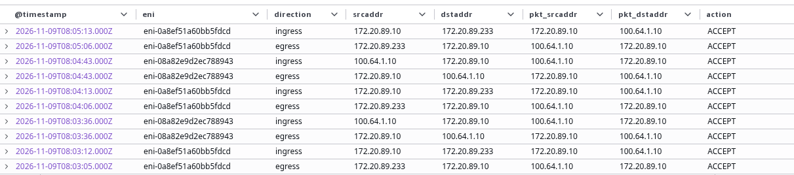

# 추가 과제 C. 지표와 로그로 확인하기

1:1 NAT가 정말 주소를 바꿨는지 CloudWatch 지표와 Flow Logs로 확인합니다. 지표와 로그는 몇 분 늦게 나타납니다. 그래서 먼저 VM에서 트래픽을 만들고 3~5분 기다립니다.

```bash
ping -c 200 100.64.2.10
```



## C-1. NAT 지표 { #c1 }

1. **CloudWatch** 콘솔 → **Metrics** → **All metrics** → **TransitGateway** → **Per-TransitGatewayAttachment Metrics**를 고릅니다.
2. 세 Transit Gateway 연결의 `PacketsInNAT`, `PacketsOutNAT`을 선택합니다.
3. **Graphed metrics** 탭에서 **Statistic**을 **Sum**으로 바꿉니다.
4. 그래프 종류를 **Number**로 바꿉니다. **Options** 탭의 **Value**에서 **Time range value**를 고릅니다(시간 범위 전체의 합을 보여 줍니다).
5. 오른쪽 위 시간 범위를 **Custom**으로 ping을 보낸 몇 분에 맞춥니다.

{ .shot }

**결과**

- ping 200개를 보내면 DXGW 연결과 VPC-A 연결의 `PacketsInNAT`, `PacketsOutNAT`이 **모두 200**입니다. 두 연결 모두에서 주소가 바뀌었기 때문입니다.
- VPC-B 연결의 NAT 지표는 **0**입니다. 규칙이 없으니 바꾼 것이 없습니다.

| 지표 | 뜻 |
|---|---|
| `PacketsInNAT` | 그 연결로 **들어올 때** 출발지 주소를 바꾼 패킷 수 |
| `PacketsOutNAT` | 그 연결로 **나갈 때** 목적지 주소를 되돌린 패킷 수 |
| `PacketDropCountBlackhole` | Blackhole 경로 때문에 버린 패킷 수([추가 과제 B-1](extra-b.md#b1)에서 늘어남) |

## C-2. 두 Flow Logs 비교 { #c2 }

**CloudWatch** → **Logs Insights**를 엽니다. 새 화면(**Log Analytics**)이 열려도 같습니다.

1. **Query scope**의 **Log group**에서 로그 그룹을 고릅니다.
2. 시간 범위를 **1h**로 둡니다.
3. 아래 쿼리를 붙여 넣고 **Run**을 누릅니다. 쿼리 안의 `N`은 내 Pod 번호로 바꿉니다.

**TGW Flow Logs** — 로그 그룹 `/tgwnat/tgw-flow-logs`

```text
parse @message "* * * * * * * * * * * * * * * * * * * * * * * * * * * * * * * * * * * *" as ver, rtype, acct, tgw, attachment, sacct, dacct, svpc, dvpc, ssub, dsub, seni, deni, saz, daz, pair, srcaddr, dstaddr, srcport, dstport, proto, packets, bytes, tstart, tend, status, iptype, nr, bh, mtu, ttl, flags, region, direction, s1, s2
| filter srcaddr = "172.20.N.10" and dstaddr = "172.20.N.10"
| display @timestamp, attachment, direction, srcaddr, dstaddr, packets
| sort @timestamp desc
| limit 10
```

{ .shot }

**VPC Flow Logs** — 로그 그룹 `/tgwnat/vpc-flow-logs`

```text
parse @message "* * * * * * * * * * * * * * * * * * * *" as ver, vpc, eni, srcaddr, dstaddr, pkt_srcaddr, pkt_dstaddr, srcport, dstport, proto, packets, bytes, flags, iptype, tstart, tend, action, status, direction, path
| filter pkt_srcaddr = "100.64.1.10" or pkt_dstaddr = "100.64.1.10"
| display @timestamp, eni, direction, srcaddr, dstaddr, pkt_srcaddr, pkt_dstaddr, action
| sort @timestamp desc
| limit 10
```

{ .shot }

**결과**

- **TGW Flow Logs**는 VM과 VPC-A EC2 사이 트래픽을 `172.20.N.10 → 172.20.N.10`처럼 **양 끝의 실제 주소**로 남깁니다. 출발지는 바뀌기 전, 목적지는 되돌린 뒤의 주소입니다. 이 내용은 사전 검증(2026-11-03)에서 관찰한 것이고 문서에는 설명이 없습니다.
- **VPC Flow Logs**는 VPC 안에서 보이는 주소를 남깁니다. 기록은 ENI(EC2나 Transit Gateway가 VPC 안에서 쓰는 네트워크 인터페이스)마다 남습니다.
    - EC2의 ENI 기록에는 상대가 `100.64.1.10`으로 보입니다.
    - Transit Gateway의 ENI 기록에서는 `srcaddr`가 그 ENI 자신의 주소입니다. 실제 상대 주소는 `pkt_srcaddr`, `pkt_dstaddr`에 있습니다.
- 그래서 "상대에게 어떤 주소로 보였나"는 VPC Flow Logs나 패킷 캡처로 확인합니다.
