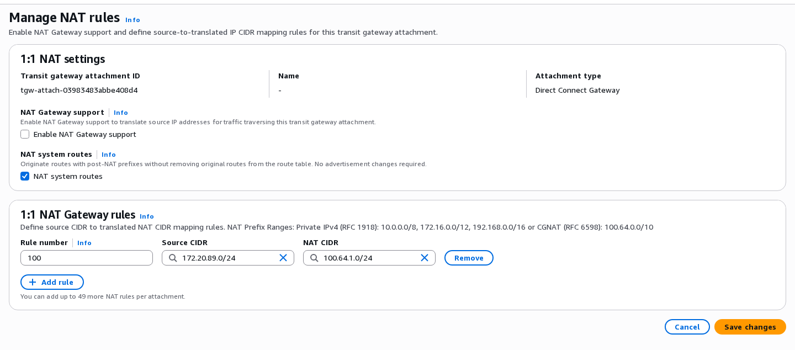
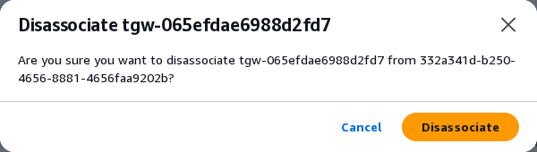
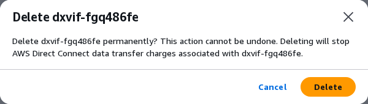
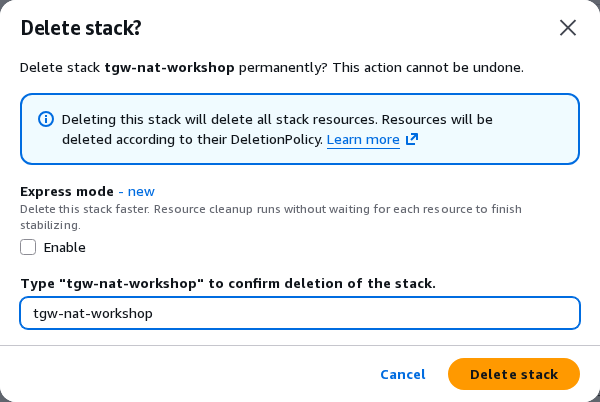

# 3-4. 리소스 정리 (약 13분)

실습이 끝나면 직접 만든 리소스를 지웁니다. 아래 **순서대로** 진행합니다. 순서가 중요한 곳은 두 군데입니다.

- Direct Connect gateway(DXGW)를 지우기 전에 두 전송 가상 인터페이스를 지워야 합니다.
- 스택이 Transit Gateway를 지우기 전에 DXGW의 게이트웨이 연결을 끊어야 합니다.

시간은 사전 테스트 때 잰 값입니다.

!!! danger "hosted connection은 지우지 마세요"
    **Connections**의 hosted connection 2개는 그대로 둡니다. 운영자가 회수합니다.

## 3-4-1. 1:1 NAT 끄기 (약 1분) { #d1 }

두 Transit Gateway 연결의 주소 변환을 멈춥니다. **Enable NAT Gateway support**를 해제하면 저장된 규칙은 **Deactivated**(비활성)가 되어 적용되지 않습니다. 규칙은 지우지 않아도 됩니다. 화면에 남는 **NAT system routes**는 NAT 대역 경로를 자동으로 만들지 정하는 별도 설정이므로 그대로 둡니다([1-3 용어 풀이](glossary.md)).

1. **VPC** 콘솔 → **Transit gateway attachments**에서 **Resource type**이 **Direct Connect Gateway**인 연결(DXGW 연결)의 ID를 누릅니다.
2. **1:1 NAT** 탭에서 **Manage 1:1 NAT**를 누르고, **Enable NAT Gateway support**를 해제한 뒤 **Save changes**를 누릅니다.
3. 이름이 `tgwnat-attach-vpc-a`인 연결도 같은 방법으로 해제합니다.

규칙을 넣을 때의 화면은 [2-3-4](lab2.md#lab2-4)와 [2-3-5](lab2.md#lab2-5)에 있습니다.

{ .shot }

**성공 확인**: **1:1 NAT** 탭에 **Disabled**, 규칙은 **Deactivated**가 보입니다.

## 3-4-2. 게이트웨이 연결 끊기 (약 2분) { #d2 }

1. **Direct Connect gateways** → 게이트웨이 ID → **Gateway associations** 탭으로 갑니다.
2. 게이트웨이 연결을 고르고 **Disassociate**를 누릅니다. 확인 창에서 다시 **Disassociate**를 누릅니다.

{ .shot }

**성공 확인**: 목록에서 게이트웨이 연결이 사라집니다. 이 연결이 남아 있으면 스택이 Transit Gateway를 지우지 못합니다.

## 3-4-3. 전송 가상 인터페이스 지우기 (약 4분) { #d3 }

**Virtual interfaces**에서 `tgw-nat-vif1`을 고르고 **Delete**를 누릅니다. 확인 창에서 다시 **Delete**를 누릅니다. `tgw-nat-vif2`도 같은 방법으로 지웁니다.

{ .shot }

**성공 확인**: 두 인터페이스의 상태가 **Deleted**가 됩니다.

## 3-4-4. Direct Connect gateway 지우기 { #d4 }

두 인터페이스가 지워진 뒤 **Direct Connect gateways**에서 게이트웨이를 고르고 **Delete**를 누릅니다. 바로 지워집니다.

## 3-4-5. 스택 지우기 (약 3분) { #d5 }

1. **CloudFormation** → `tgw-nat-workshop` → **Delete stack**을 누릅니다.
2. 확인 창의 입력란에 스택 이름 `tgw-nat-workshop`을 그대로 입력하고 **Delete stack**을 누릅니다.

{ .shot }

**성공 확인**: 스택이 목록에서 사라집니다(**DELETE_COMPLETE**). Transit Gateway, VPC, VPC-A EC2와 VPC-B EC2, 로그도 함께 지워집니다.

## 3-4-6. 마무리 { #d6 }

- 온프레미스 라우터(`rtN`)와 온프레미스 VM(`vmN`)에 추가한 설정은 그대로 두어도 됩니다. 운영자가 Pod를 처음 상태로 되돌립니다.
- 두 인터페이스의 **Deleted**, DXGW 삭제, 스택의 **DELETE_COMPLETE**를 모두 확인하면 정리가 끝납니다.
- **Connections**의 hosted connection 2개는 지우지 않고 **Available**로 남겨 둡니다. 이 연결의 포트 요금은 운영자가 회수할 때까지 발생합니다([사전 준비](prerequisites.md)).
