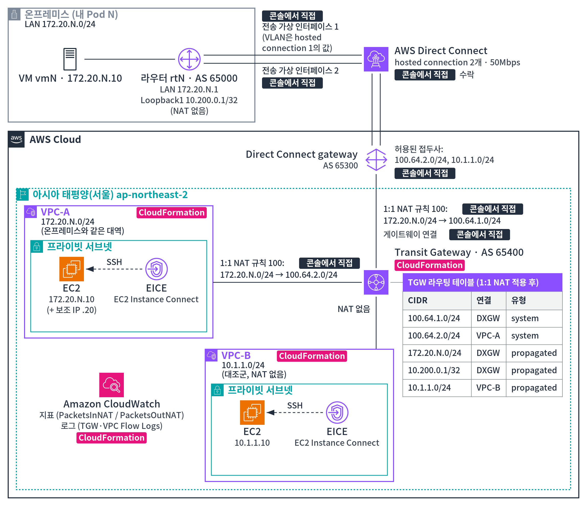

# AWS Transit Gateway 1:1 NAT로 겹치는 대역 연결하기

회사 네트워크(온프레미스)와 AWS의 VPC가 **같은 IP 대역**을 쓰면, 둘을 연결해도 서로 통신할 수 없습니다. 주소를 바꾸려면 많은 시간이 듭니다.

이 워크숍에서는 Transit Gateway의 **1:1 NAT**로 이 문제를 풉니다. 주소는 그대로 두고, Transit Gateway를 지날 때만 다른 주소로 바꿔 보이게 합니다.

| 항목 | 내용 |
|---|---|
| 대상 | VPC, Transit Gateway, Direct Connect를 들어 본 분 |
| 레벨 | 200 |
| 시간 | 2시간(발표 1시간, 실습 1시간) |
| 준비물 | 웹 브라우저. 참가자마다 AWS 계정 1개와 실습용 온프레미스 장비(Pod)를 드립니다 |
| 리전 | 아시아 태평양(서울) `ap-northeast-2` |

모르는 용어는 [용어 풀이](glossary.md)를 보세요.

## 시나리오

여러분의 Pod 번호를 **N**이라고 하겠습니다(예: 89).

- 온프레미스 LAN은 `172.20.N.0/24`입니다.
- AWS의 VPC-A도 **똑같이** `172.20.N.0/24`를 씁니다.
- 온프레미스 라우터(`rtN`)는 Direct Connect로 AWS에 연결됩니다.
- 비교를 위해 NAT를 걸지 않는 VPC-B(`10.1.1.0/24`)도 있습니다.

1:1 NAT를 적용하면 서로 이렇게 보입니다.

| 네트워크 | 실제 주소 | 상대에게 보이는 주소 |
|---|---|---|
| 온프레미스 | `172.20.N.0/24` | `100.64.1.0/24` |
| VPC-A | `172.20.N.0/24` | `100.64.2.0/24` |
| VPC-B | `10.1.1.0/24` | 그대로 |

예를 들어 온프레미스 VM(`vmN`)과 VPC-A EC2는 둘 다 `172.20.N.10`을 씁니다. 하지만 온프레미스 VM은 VPC-A EC2를 `100.64.2.10`으로 봅니다. VPC-A EC2는 온프레미스 VM을 `100.64.1.10`으로 봅니다.

## 무엇을 배우나요

1. Direct Connect로 온프레미스를 Transit Gateway에 연결하는 방법
2. 같은 대역을 쓰면 어떤 문제가 생기는지
3. 콘솔에서 1:1 NAT를 설정하고 결과를 확인하는 방법
4. 양쪽에서 상대 주소가 어떻게 보이는지
5. NAT 경로 설정과 관측 방법(추가 과제)

## 진행 순서

| 시간 | 구분 | 내용 |
|---|---|---|
| 0:00–0:10 | [실습 0](lab0.md) | 로그인, hosted connection 수락, 스택 배포 시작 |
| 0:10–0:35 | 발표 1 | 시나리오, Direct Connect·Transit Gateway 복습, 1:1 NAT 개념 |
| 0:35–1:00 | [실습 1](lab1.md) | Direct Connect 연결과 온프레미스 라우터 설정 |
| 1:00–1:25 | 발표 2 | NAT 규칙과 경로, 관측 방법 |
| 1:25–1:50 | [실습 2](lab2.md) | 문제 확인 → 1:1 NAT 적용 → 결과 확인 |
| 1:50–2:00 | 발표 3 | 정리, [리소스 정리](extra-d.md) 안내 |

실습 0을 발표 앞에 두는 이유가 있습니다. hosted connection과 CloudFormation 스택은 준비되는 데 몇 분씩 걸립니다. 발표를 듣는 동안 준비가 끝납니다.

실습을 마치고 더 해 보고 싶다면 [추가 과제](extra-a.md)를 하세요.
