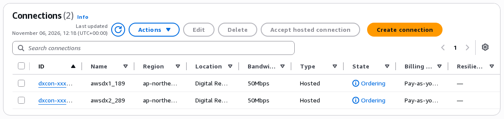
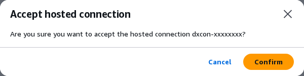
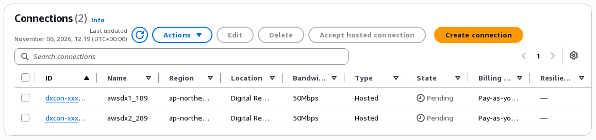
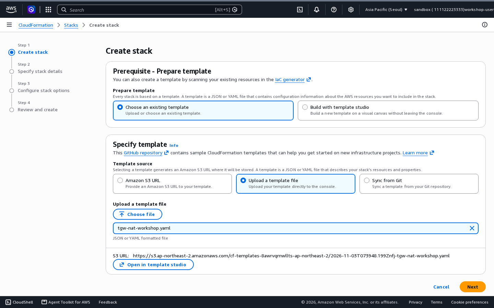
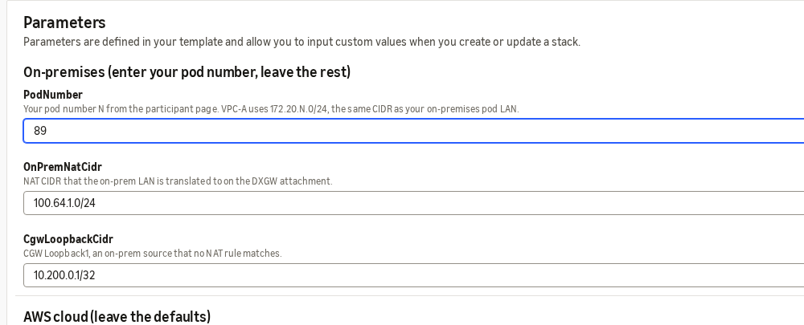
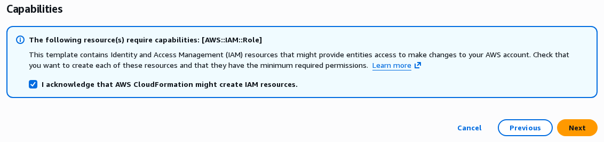
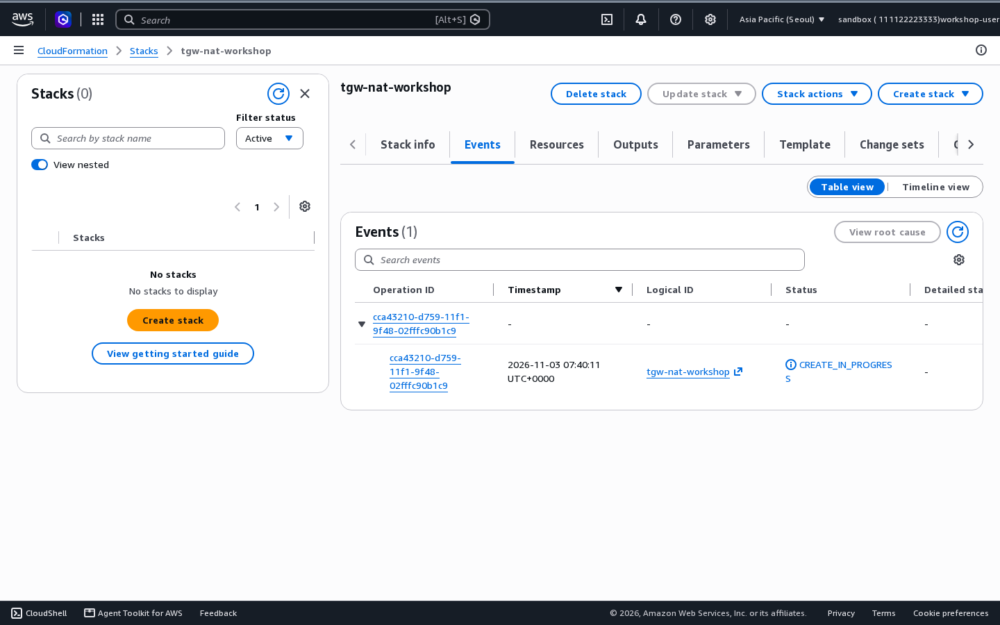

# 2-1. 시작하기 (10분)

오래 걸리는 두 가지를 먼저 시작해 둡니다. hosted connection 수락과 스택 배포입니다. 준비가 끝나기를 기다리지 않고 실습 2-2로 넘어갑니다.

## 2-1-1. 웹 터미널 열어 보기 { #lab0-1 }

1. 실습 장비 페이지를 엽니다. 내 Pod 번호, DX1·DX2 VLAN(Virtual LAN)을 [적어 둡니다](prerequisites.md#notes).
2. 온프레미스 라우터(`rtN`)를 누릅니다. 웹 터미널에 `rtN#`이 보이면 됩니다.
3. 왼쪽 위 홈 아이콘으로 돌아와 온프레미스 VM(Virtual Machine, `vmN`)도 엽니다. `labuser@vmN:~$`가 보이면 됩니다.

!!! tip "탭을 여러 개 쓰세요"
    온프레미스 라우터, 온프레미스 VM, AWS 콘솔을 브라우저 탭으로 따로 열어 두면 오가기 편합니다.

## 2-1-2. hosted connection 수락 { #lab0-2 }

hosted connection(호스팅 연결)은 Direct Connect 파트너가 만들어 여러분 계정에 넘겨 준 회선입니다. 수락해야 쓸 수 있습니다. 실습 2-2에서 이 회선 위에 전송 가상 인터페이스를 만듭니다. 용어는 [용어 풀이](glossary.md)를 보세요.

1. AWS 콘솔에 로그인합니다. 오른쪽 위 리전을 강사가 안내한 리전으로 맞춥니다. 예제 화면은 **Asia Pacific (Seoul)** 기준입니다.
2. **Direct Connect** 콘솔 → 왼쪽 메뉴 **Connections**를 엽니다.
3. 이름이 `awsdx1_…`, `awsdx2_…`인 hosted connection 2개가 보입니다. 상태는 **Ordering**입니다.

    { .shot }

4. `awsdx1_…` 줄 왼쪽의 확인란을 선택하고 **Accept hosted connection**을 누릅니다.
5. 확인 창에서 **Confirm**을 누릅니다.

    { .shot }

6. `awsdx2_…`도 같은 방법으로 수락합니다.

**성공 확인**: 두 연결의 상태가 **Pending**으로 바뀝니다. 몇 분 뒤 **Available**이 됩니다(사전 테스트 시 3~6분). 기다리지 말고 다음으로 넘어갑니다.

{ .shot }

## 2-1-3. 스택 배포 { #lab0-3 }

!!! warning "배포하기 전에 리전부터 확인합니다"
    스택은 **강사가 안내한 리전**에 배포합니다. AWS 콘솔 오른쪽 위의 리전 선택 메뉴에서 그 리전을 먼저 고른 뒤 시작합니다.

    이 워크숍의 예제 화면은 **아시아 태평양(서울) `ap-northeast-2`**에서 진행한다고 보고 만들었습니다. 다른 리전을 안내받아도 실습 순서는 같습니다.

    스택이 만드는 Transit Gateway, VPC, EC2, Flow Logs는 모두 이 리전에 생깁니다. 이후 실습에서 이 리소스를 볼 때도 같은 리전을 고릅니다.

스택은 실습의 바탕이 되는 다음 리소스를 만듭니다.

- Transit Gateway
- VPC-A(`172.20.N.0/24`)와 VPC-B(`10.1.1.0/24`)
- 두 VPC를 Transit Gateway에 붙이는 Transit Gateway 연결 2개(VPC-A 연결, VPC-B 연결)
- VPC-A EC2(`172.20.N.10`)와 VPC-B EC2(`10.1.1.10`)
- EC2 Instance Connect Endpoint: 두 EC2에 브라우저로 접속할 때 씁니다
- Flow Logs: Transit Gateway와 두 VPC에서 어떤 주소 사이에 트래픽이 오갔는지 기록합니다

핵심인 Direct Connect 연결과 1:1 NAT(Network Address Translation)는 이어지는 실습에서 직접 만듭니다. 용어는 [용어 풀이](glossary.md)를 보세요.

1. 템플릿 파일을 내려받습니다: [tgw-nat-workshop.yaml](assets/tgw-nat-workshop.yaml){ download }
2. **CloudFormation** 콘솔 → **Create stack** → **With new resources (standard)** 를 누릅니다.
3. **Upload a template file** → **Choose file**로 내려받은 파일을 고르고 **Next**를 누릅니다.

    { .shot }

4. **Stack name**에 `tgw-nat-workshop`을 넣습니다. **Parameters**의 **PodNumber**에 내 Pod 번호 N을 넣습니다. 강사가 가용 영역을 안내했다면 **Az1**, **Az2**에도 넣습니다. 나머지 값은 그대로 두고 **Next**를 누릅니다.

    PodNumber는 VPC-A의 대역을 정합니다. VPC-A는 온프레미스 대역과 같은 `172.20.N.0/24`로 만들어집니다. 예를 들어 Pod 번호가 89이면 온프레미스와 VPC-A 모두 `172.20.89.0/24`입니다. 이 워크숍은 일부러 겹치게 만든 이 두 대역을 1:1 NAT로 잇습니다.

    { .shot }

5. 다음 화면 맨 아래 **Capabilities**에서 **I acknowledge that AWS CloudFormation might create IAM resources.** 를 선택하고 **Next**를 누릅니다. Flow Logs를 저장하는 데 필요한 권한(IAM 역할)을 만들기 때문입니다.

    { .shot }

6. 마지막 화면에서 **Submit**을 누릅니다.

**성공 확인**: 스택 상태가 **CREATE_IN_PROGRESS**입니다. 약 6분 뒤 **CREATE_COMPLETE**가 됩니다.

{ .shot }

여기까지 하고 [실습 2-2](lab1.md)로 넘어갑니다.
