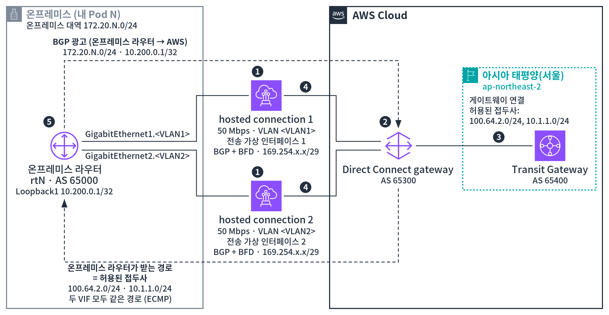
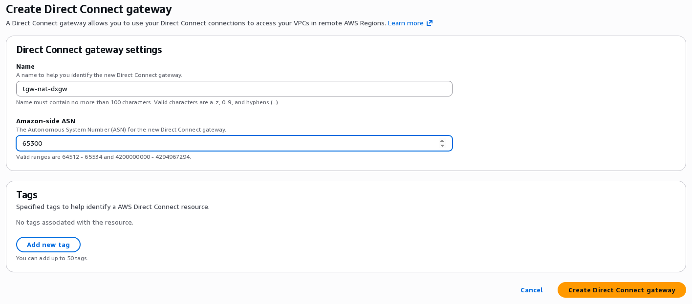
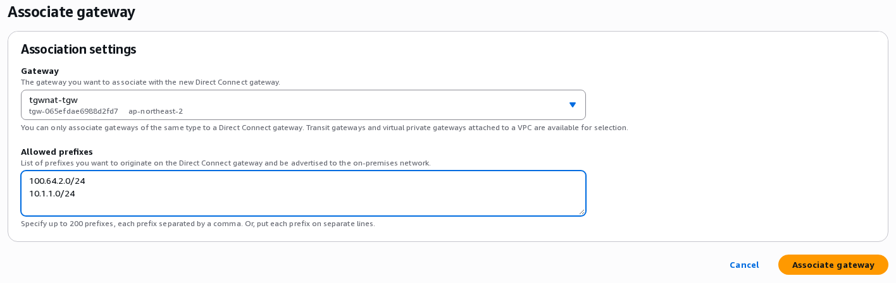
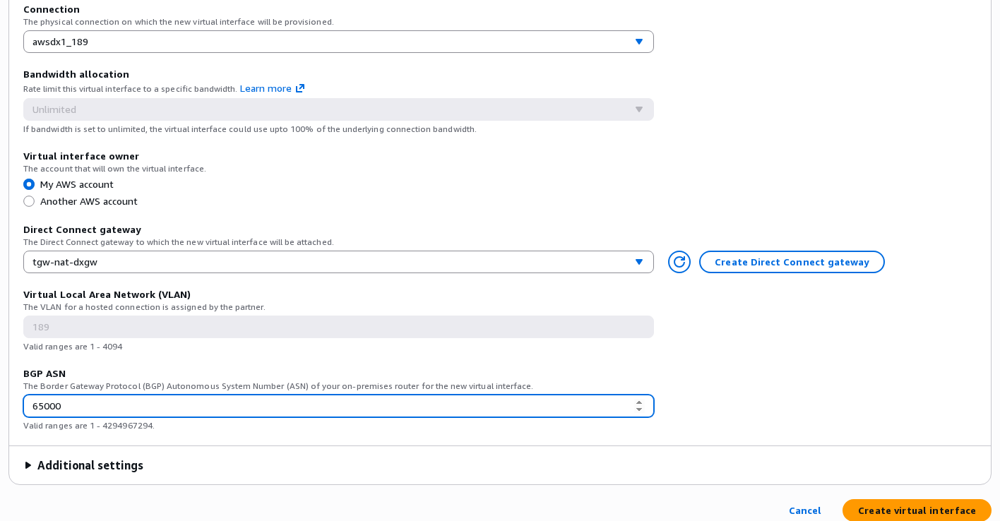
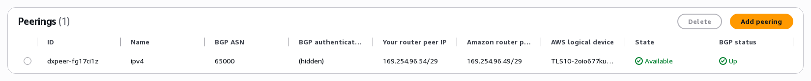
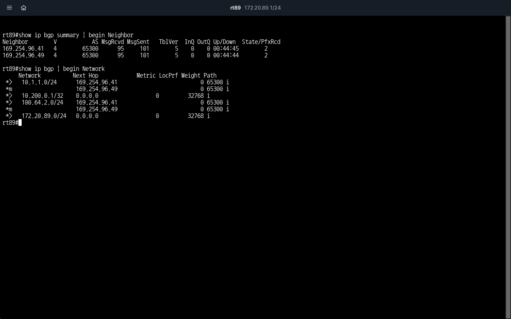
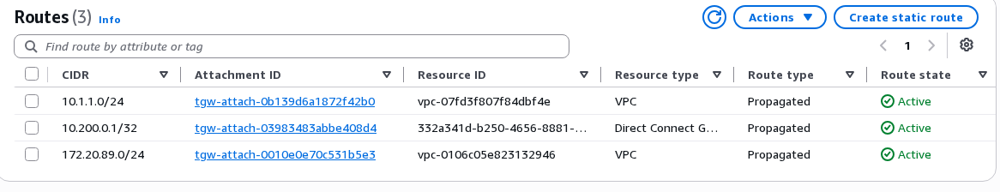

# 2-2. Direct Connect 연결 (30분)

온프레미스 라우터(`rtN`)를 AWS의 Transit Gateway까지 연결합니다. 아직 NAT(Network Address Translation)는 걸지 않습니다.

아래 그림 3의 번호 순서로 만듭니다. ①(hosted connection 수락)은 실습 2-1에서 이미 했습니다. 처음 보는 용어는 [1-3. 용어 풀이](glossary.md)를 보세요.

<figure markdown="span">
  
  <figcaption>그림 3. Direct Connect 연결 구성</figcaption>
</figure>

| 번호 | 단계 | 내용 |
|---|---|---|
| ① | hosted connection 수락 | 파트너가 VLAN(Virtual LAN)을 정해 만든 50 Mbps hosted connection 2개를 Direct Connect 콘솔에서 각각 수락합니다. |
| ② | Direct Connect gateway(DXGW) 만들기 | 전송 가상 인터페이스와 Transit Gateway를 이어 주는 리소스입니다. 특정 리전에 속하지 않는 글로벌 리소스이고, Amazon 측 ASN(Autonomous System Number)은 65300입니다. |
| ③ | Transit Gateway와 게이트웨이 연결 | Transit Gateway(AS 65400, AS는 Autonomous System)에 DXGW 연결(Transit Gateway 연결)이 생깁니다. 허용된 접두사 `100.64.2.0/24`, `10.1.1.0/24`가 그대로 온프레미스 라우터에 광고됩니다. |
| ④ | 전송 가상 인터페이스(transit VIF, Virtual Interface) 만들기 | hosted connection마다 하나씩, 그 VLAN으로 만들고 DXGW에 붙입니다. 피어 IP(`169.254.x.x/29`)와 BGP(Border Gateway Protocol) 인증 키는 AWS가 만듭니다. |
| ⑤ | 온프레미스 라우터 BGP 설정 | `GigabitEthernet1.<VLAN1>`, `GigabitEthernet2.<VLAN2>`에서 AS 65300과 BGP로 연결하고 `172.20.N.0/24`, `10.200.0.1/32`를 광고합니다. 회선 끊김을 빨리 알아채도록 BFD(Bidirectional Forwarding Detection)를 함께 씁니다. 두 전송 가상 인터페이스로 받은 같은 경로는 둘에 나눠 보냅니다(ECMP, Equal-Cost Multi-Path). |

시작하기 전에 확인합니다.

- 실습 2-1의 hosted connection 2개가 **Available**인가요?
- 스택 `tgw-nat-workshop`이 **CREATE_COMPLETE**인가요? 아직이면 2-2-1과 2-2-3을 먼저 하고, 스택이 끝나면 2-2-2를 합니다.

## 2-2-1. Direct Connect gateway 만들기 { #lab1-1 }

1. **Direct Connect** 콘솔 → **Direct Connect gateways** → **Create Direct Connect gateway**를 누릅니다.
2. **Name**에 `tgw-nat-dxgw`, **Amazon-side ASN**에 `65300`을 넣고 **Create Direct Connect gateway**를 누릅니다.

{ .shot }

ASN은 BGP에서 쓰는 번호입니다. 이 워크숍은 온프레미스 라우터(`rtN`) 65000, Direct Connect gateway 65300, Transit Gateway 65400으로 서로 다르게 씁니다.

## 2-2-2. Transit Gateway와 연결하기 { #lab1-2 }

게이트웨이 연결은 몇 분 걸리므로 일찍 시작해 둡니다.

게이트웨이 연결의 허용된 접두사(**Allowed prefixes**)는 온프레미스 라우터(`rtN`)에 BGP로 **그대로 광고**할 대역입니다. 광고만 정할 뿐, NAT 규칙이나 Transit Gateway 경로를 만들지는 않습니다.

!!! warning "중요: Allowed prefixes에는 VPC-A의 실제 대역이 아니라 NAT 대역을 넣습니다"
    온프레미스는 VPC-A를 실제 주소가 아니라 NAT 주소(`100.64.2.10` 등)로 찾아갑니다. 그래서 온프레미스 라우터가 받아야 할 경로도 VPC-A의 NAT 대역입니다.

    | 대역 | 넣나요 | 이유 |
    |---|---|---|
    | `100.64.2.0/24`(VPC-A의 NAT 대역) | **넣습니다** | 온프레미스 라우터가 이 경로를 받아야 `100.64.2.10`으로 보낼 수 있습니다 |
    | `172.20.N.0/24`(VPC-A의 실제 대역) | **넣지 않습니다** | 온프레미스 대역과 같아서 받아도 쓸 수 없습니다. 온프레미스 라우터는 이 주소를 자기 LAN으로 보냅니다 |
    | `10.1.1.0/24`(VPC-B) | **넣습니다** | VPC-B에는 NAT 규칙이 없어 실제 대역 그대로 보입니다 |

    지금은 광고할 대역만 정해 둡니다. `100.64.2.0/24`로 가는 통신은 실습 2-3에서 NAT 규칙을 넣은 뒤에 됩니다.

아래 순서로 연결합니다.

1. **Direct Connect gateways** 목록에서 방금 만든 게이트웨이의 ID를 누릅니다(목록에는 이름 대신 ID가 보입니다).
2. **Gateway associations** 탭 → **Associate gateway**를 누릅니다.
3. **Gateway**에서 스택이 만든 Transit Gateway(`tgwnat-tgw`)를 고릅니다.
4. **Allowed prefixes**에 아래 두 줄을 넣고 **Associate gateway**를 누릅니다.

    ```text
    100.64.2.0/24
    10.1.1.0/24
    ```

{ .shot }

**성공 확인**: 상태가 **associating**에서 약 3분 뒤 **associated**가 됩니다.

## 2-2-3. 전송 가상 인터페이스 2개 만들기 { #lab1-3 }

hosted connection마다 하나씩 만듭니다.

1. **Virtual interfaces** → **Create virtual interface**를 누릅니다.
2. **Virtual interface type**에서 **Transit**을 고릅니다.
3. 아래 값을 넣습니다.

    | 항목 | 첫 번째 | 두 번째 |
    |---|---|---|
    | Virtual interface name | `tgw-nat-vif1` | `tgw-nat-vif2` |
    | Connection | `awsdx1_…` | `awsdx2_…` |
    | Direct Connect gateway | `tgw-nat-dxgw` | `tgw-nat-dxgw` |
    | VLAN | 자동으로 채워짐 | 자동으로 채워짐 |
    | BGP ASN | `65000` | `65000` |

4. **Additional settings**는 그대로 둡니다. 온프레미스 라우터(`rtN`)와 주고받을 IP와 BGP 키는 AWS가 만들어 줍니다.
5. **Create virtual interface**를 누릅니다. 두 번째도 같은 방법으로 만듭니다.

{ .shot }

hosted connection 하나에는 전송 가상 인터페이스를 하나만 만들 수 있습니다. 잘못 만들었으면 지우고 다시 만듭니다.

**성공 확인**: 두 인터페이스의 상태가 **Pending** 또는 **Down**입니다. 온프레미스 라우터 설정을 마치면 **Available**이 됩니다.

## 2-2-4. BGP 값 확인 { #lab1-4 }

온프레미스 라우터(`rtN`)가 전송 가상 인터페이스마다 AWS와 BGP 세션을 맺는 데 쓸 값을 확인합니다. 2-2-5에서 라우터 설정 생성기에 넣습니다.

| 값 | 라우터 설정에서 쓰는 곳 | 생성기 칸(DX1 / DX2) |
|---|---|---|
| **Your router peer IP** | 온프레미스 라우터 서브인터페이스의 주소 | ⑧ / ⑬ |
| **Amazon router peer IP** | BGP 이웃(AWS 쪽)의 주소 | ⑨ / ⑭ |
| **BGP authentication key** | BGP 세션의 인증 키 | ⑩ / ⑮ |

두 피어 IP는 전송 가상 인터페이스에서 온프레미스 라우터와 AWS 라우터가 쓰는 `169.254.x.x/29` 주소입니다. BGP와 BFD가 이 주소로 연결되고, Amazon router peer IP는 받은 경로의 **Next Hop**으로도 보입니다(2-2-6). 온프레미스 대역(`172.20.N.0/24`)이나 NAT 대역과는 관계가 없습니다.

1. **Virtual interfaces**에서 `tgw-nat-vif1`의 ID를 누릅니다.
2. **Peerings** 탭에서 위 세 값을 적습니다.
3. `tgw-nat-vif2`도 같은 값을 적습니다.

{ .shot }

위 화면은 온프레미스 라우터(`rtN`) 설정을 마친 뒤의 모습입니다. 지금은 **BGP status**가 **Down**이어도 괜찮습니다.

## 2-2-5. 온프레미스 라우터 설정 { #lab1-5 }

1. [라우터 설정 생성기](router-config.md)를 새 탭으로 엽니다. 페이지 위 그림 10의 번호는 입력 칸의 번호와 같습니다.
2. Pod 번호(①)를 넣습니다. 온프레미스 대역(②)은 자동으로 채워집니다.
3. 미리 채워진 값을 확인합니다. Loopback1(③)과 라우터 인터페이스(⑥⑪)는 그대로 둡니다. ASN(④⑤)은 2-2-1, 2-2-3에서 넣은 값과 같은지만 봅니다.
4. DX1(⑦–⑩)에 `tgw-nat-vif1`의 값을 넣습니다. VLAN(⑦)은 전송 가상 인터페이스 상세의 **VLAN**이고, 나머지는 2-2-4에서 적은 값입니다.
5. DX2(⑫–⑮)에 `tgw-nat-vif2`의 값을 같은 방법으로 넣습니다.
6. 설정이 만들어지면 **복사**를 누릅니다.
7. 온프레미스 라우터(`rtN`) 터미널에 붙여 넣습니다. `%`로 시작하는 오류가 없으면 됩니다.

설정이 하는 일은 [라우터 설정 생성기](router-config.md#explain) 페이지에 설명해 두었습니다.

??? tip "콘솔의 Sample configuration"
    전송 가상 인터페이스의 **Actions** → **Sample configuration**에서도 라우터 설정 예시를 내려받을 수 있습니다. 다만 온프레미스 라우터의 종류가 목록에 없어 손볼 곳이 많습니다. 그래서 생성기를 씁니다.

## 2-2-6. 연결 확인 { #lab1-6 }

라우터 설정을 붙여 넣은 뒤 BGP가 연결되고 두 전송 가상 인터페이스가 **Available**이 되기까지 몇 분 걸립니다. 사전 테스트에서는 약 3분 걸렸습니다.

온프레미스 라우터(`rtN`) 터미널에서 실행합니다.

```text
show ip bgp summary | begin Neighbor
show ip bgp | begin Network
```

{ .shot }

**성공 확인**

- 두 이웃의 마지막 칸(**State/PfxRcd**)이 숫자 `2`입니다. 이웃마다 경로를 2개 받았다는 뜻입니다. 몇 분 기다려도 `Active`나 `Idle`이면 [문제 해결](troubleshooting.md)을 보세요.
- `10.1.1.0/24`와 `100.64.2.0/24`를 받았습니다. 2-2-2에서 넣은 허용된 접두사입니다.
- 두 경로가 각각 **Next Hop** 2개(두 전송 가상 인터페이스의 Amazon router peer IP)로 보입니다. `*>`는 가장 좋은 경로, `*m`은 함께 쓰는 경로라는 표시입니다(ECMP).
- 콘솔의 두 전송 가상 인터페이스가 **Available**, **BGP status**가 **Up**입니다.

이제 VPC-B까지 통신해 봅니다. 보내는 주소는 온프레미스 대역(`172.20.N.0/24`)이 아니라 Loopback1(`10.200.0.1`)로 정합니다. Loopback1은 온프레미스 라우터 안의 가상 인터페이스입니다.

- `172.20.N.0/24`는 VPC-A와 겹칩니다. 그래서 VPC-B의 응답이 VPC-A로 갑니다. 이 문제는 실습 [2-3-2](lab2.md#lab2-2)에서 확인합니다.
- `10.200.0.1`은 어디와도 겹치지 않습니다. 응답이 Transit Gateway 라우팅 테이블의 `10.200.0.1/32` 경로를 따라 DXGW 연결로 돌아오므로, NAT 없이 기본 연결을 확인할 수 있습니다.
- 실습 2-3의 NAT 규칙(원래 대역 `172.20.N.0/24`)에도 들지 않으므로, NAT를 켠 뒤에도 이 주소는 바뀌지 않습니다.

두 테스트 모두 보내는 주소를 Loopback1로 정합니다. `ping`은 `source`, `telnet`은 앞에 `/`를 붙인 `/source-interface`로 씁니다.

명령은 한 줄씩 넣고, 앞 명령의 결과가 나온 뒤에 다음 명령을 넣습니다. 코드 상자 오른쪽 위의 복사 버튼을 누르면 그 줄이 복사됩니다.

**ping 테스트**

```text
ping 10.1.1.10 source Loopback1 repeat 5
```

사전 테스트 때 실제로 나온 출력입니다(Pod 89). 시간은 매번 다릅니다.

```text
rt89#ping 10.1.1.10 source Loopback1 repeat 5
Type escape sequence to abort.
Sending 5, 100-byte ICMP Echos to 10.1.1.10, timeout is 2 seconds:
Packet sent with a source address of 10.200.0.1
!!!!!
Success rate is 100 percent (5/5), round-trip min/avg/max = 5/6/10 ms
```

**성공 확인**: `!!!!!`이고 `Success rate is 100 percent (5/5)`입니다.

**telnet 테스트**

ping이 끝나고 프롬프트(`rtN#`)가 다시 나오면 넣습니다.

```text
telnet 10.1.1.10 8080 /source-interface Loopback1
```

`Trying 10.1.1.10, 8080 ... Open`이 나오면 그 다음 줄에서 커서만 깜박이고 아무것도 나오지 않습니다. 서버가 요청을 기다리는 상태입니다. 아래 줄을 넣고 Enter를 **두 번** 누르면 응답이 나옵니다.

```text
GET / HTTP/1.0
```

!!! warning "`Open` 뒤에 바로 끊기면"
    `Open` 다음에 응답 없이 `[Connection to 10.1.1.10 closed by foreign host]`가 나오면 `telnet` 명령만 다시 넣고, `Open`이 나온 뒤에 `GET / HTTP/1.0`을 넣으세요.

사전 테스트 때 실제로 나온 출력입니다(Pod 89). 포트 번호와 시간은 매번 다릅니다.

```text
rt89#telnet 10.1.1.10 8080 /source-interface Loopback1
Trying 10.1.1.10, 8080 ... Open
GET / HTTP/1.0

HTTP/1.0 200 OK
Server: BaseHTTP/0.6 Python/3.9.25
Date: Fri, 06 Nov 2026 10:50:05 GMT
Content-Type: text/plain
Content-Length: 31

vpc-b-ec2 saw 10.200.0.1:30721

[Connection to 10.1.1.10 closed by foreign host]
```

**성공 확인**: 응답에 `vpc-b-ec2 saw 10.200.0.1:<포트>`가 보입니다. VPC-B가 보낸 쪽 주소를 바뀌지 않은 그대로 봤다는 뜻입니다.

## 2-2-7. 라우팅 테이블 보기 { #lab1-7 }

**VPC** 콘솔 → **Transit gateway route tables** → 라우팅 테이블 ID → **Routes** 탭을 엽니다.

{ .shot }

`172.20.N.0/24`가 VPC-A 하나만 가리킵니다. 온프레미스도 같은 대역을 광고했지만 보이지 않습니다. 같은 대역이면 VPC의 경로가 우선하기 때문입니다. 실습 2-3에서 이 때문에 생기는 문제를 확인합니다.
