# 2-3. 1:1 NAT 적용 (30분)

먼저 같은 대역 때문에 발생하는 문제를 실습을 통해 알아봅니다. 그런 다음 1:1 NAT(Network Address Translation)를 적용해 이 문제를 해결합니다.

!!! tip "브라우저 탭을 두 개 열어 두세요"
    이 실습은 VPC-A EC2 터미널과 VPC 콘솔을 번갈아 씁니다. 2-3-1에서 **Connect**를 누르면 새 탭이 열리지 않고, 보고 있던 콘솔 탭이 터미널 화면으로 바뀝니다. 그러니 VPC 콘솔은 브라우저의 새 탭에 따로 열어 두세요. 터미널을 닫지 않고 두 화면을 오갈 수 있습니다.

## 2-3-1. VPC-A EC2에 접속하기 { #lab2-1 }

VPC-A EC2에는 인터넷 주소가 없습니다. 그래서 스택이 만든 EC2 Instance Connect Endpoint로 브라우저에서 접속합니다.

1. **EC2** 콘솔 → **Instances** → `tgwnat-vpc-a-ec2`를 고르고 **Connect**를 누릅니다.
2. **In web browser** 탭에서 **EC2 Instance Connect Endpoint**를 고릅니다. 엔드포인트와 사용자 이름(`ec2-user`)은 자동으로 채워집니다.
3. **Connect**를 누르면 터미널이 열립니다.

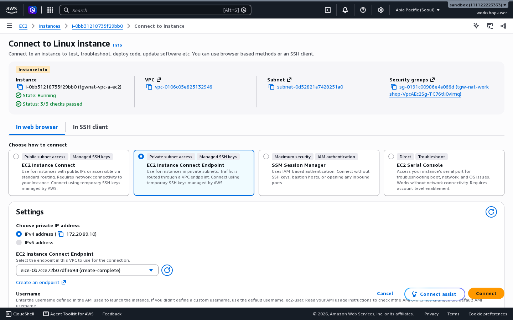{ .shot }

터미널은 최대 1시간 유지됩니다. 끊기면 다시 **Connect**를 누릅니다.

## 2-3-2. 문제 확인: 응답이 엉뚱한 곳으로 갑니다 { #lab2-2 }

온프레미스 VM(Virtual Machine, `vmN`)에서 VPC-B로 ping을 보내면 무슨 일이 생기는지 봅니다.

<figure markdown="span">
  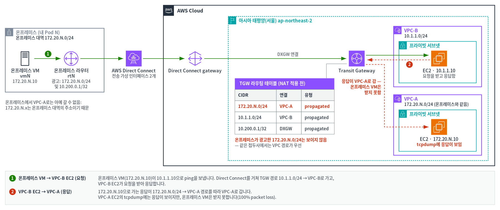
  <figcaption>그림 4. NAT 적용 전: VPC-B의 응답이 VPC-A로 가는 문제</figcaption>
</figure>

| 번호 | 흐름 | 내용 |
|---|---|---|
| ① | 온프레미스 VM → VPC-B EC2 (요청) | 온프레미스 VM(`172.20.N.10`)이 `10.1.1.10`으로 ping을 보냅니다. Direct Connect를 거쳐 TGW(Transit Gateway) 경로 `10.1.1.0/24` → VPC-B로 가고, VPC-B EC2가 요청을 받아 응답합니다. |
| ② | VPC-B EC2 → VPC-A (응답) | `172.20.N.10`으로 가는 응답이 `172.20.N.0/24` → VPC-A 경로를 따라 VPC-A로 갑니다. VPC-A EC2의 tcpdump에는 응답이 보이지만, 온프레미스 VM은 받지 못합니다(100% packet loss). |

1. VPC-A EC2 터미널에서 ping 패킷을 지켜봅니다.

    ```bash
    sudo tcpdump -ni ens5 icmp
    ```

2. 온프레미스 VM(`vmN`) 터미널에서 VPC-B로 ping을 보냅니다.

    ```bash
    ping -c 8 10.1.1.10
    ```

**결과(실패가 맞습니다)**

- 온프레미스 VM의 ping은 **100% packet loss**로 실패합니다.
- 그런데 VPC-A EC2에 `10.1.1.10 > 172.20.N.10: ICMP echo reply`가 찍힙니다.
- VPC-B는 응답을 보냈지만, Transit Gateway가 그 응답을 VPC-A로 보낸 것입니다. 라우팅 테이블에서 `172.20.N.0/24`가 VPC-A를 가리키기 때문입니다.

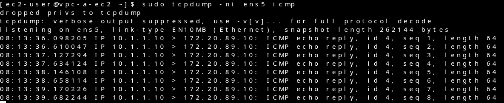{ .shot }

온프레미스에서 VPC-A로는 처음부터 갈 수 없습니다. VPC-A의 주소가 온프레미스 대역의 주소와 같기 때문입니다. tcpdump는 **Ctrl+C**로 멈춥니다.

## 2-3-3. 1:1 NAT는 어디서 주소를 바꾸나 { #lab2-3 }

1:1 NAT 규칙은 Transit Gateway 연결(attachment)마다 둡니다. 규칙에는 대역 두 개를 넣습니다. **Source CIDR**은 바꾸기 전의 실제 대역(원래 대역)입니다. **NAT CIDR**은 바뀐 뒤 상대에게 보이는 대역(NAT 대역)입니다([용어 풀이](glossary.md)). CIDR(Classless Inter-Domain Routing)는 `172.20.N.0/24`처럼 대역을 적는 방식입니다.

<figure markdown="span">
  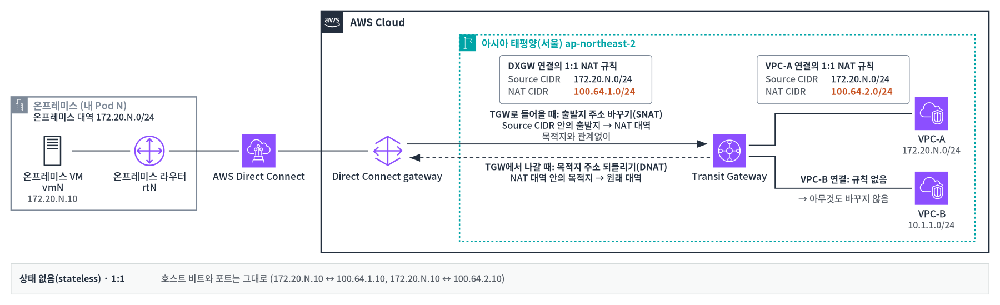
  <figcaption>그림 5. Transit Gateway 1:1 NAT 규칙이 주소를 바꾸는 곳(SNAT·DNAT)</figcaption>
</figure>

Transit Gateway에서 제공하는 1:1 NAT에는 두 가지 특징이 있습니다.

- **1:1로 바꿉니다**: 주소 하나를 정해진 주소 하나로 바꿉니다. 원래 대역과 NAT 대역은 접두사 길이가 같아야 합니다([지켜야 할 조건](concepts.md#limits)). 앞의 네트워크 부분만 바뀌고, 호스트 부분(호스트 비트)과 포트는 그대로입니다. 이 실습은 `/24`라서 마지막 숫자가 그대로입니다. 그래서 온프레미스 VM `172.20.N.10`은 늘 `100.64.1.10`으로, VPC-A EC2 `172.20.N.10`은 늘 `100.64.2.10`으로 보입니다.
- **연결을 기억하지 않습니다(stateless)**: Transit Gateway는 패킷마다 규칙만 보고 주소를 바꿉니다. 그래서 어느 쪽에서 먼저 통신을 시작해도 똑같이 동작합니다.

주소를 바꾸는 곳은 Transit Gateway 연결입니다. 그래서 1:1 NAT 설정도 Transit Gateway 연결에 있습니다(**Transit gateway attachments** → 연결 → **1:1 NAT** 탭). 규칙 하나는 그 연결을 지나는 패킷의 방향에 따라 SNAT과 DNAT을 짝으로 처리합니다.

- **그 연결로 Transit Gateway에 들어올 때(SNAT)**: 출발지 주소가 원래 대역에 있으면 NAT 대역으로 바꿉니다. 목적지가 어디든 바꿉니다.
- **그 연결로 Transit Gateway에서 나갈 때(DNAT)**: 목적지 주소가 NAT 대역에 있으면 원래 주소로 되돌립니다.

요청과 응답은 같은 연결을 반대 방향으로 지나갑니다. 그래서 규칙 하나로 두 방향이 모두 처리되고, 돌아오는 방향의 규칙은 따로 넣지 않습니다.

## 2-3-4. DXGW 연결에 규칙 넣기 { #lab2-4 }

온프레미스 주소 `172.20.N.0/24`가 AWS에서 `100.64.1.0/24`로 보이게 합니다.

1. **VPC** 콘솔 → **Transit gateway attachments**에서 **Resource type**이 **Direct Connect Gateway**인 연결의 ID를 누릅니다.
2. **1:1 NAT** 탭(**1:1 NAT - new**)에서 **Manage 1:1 NAT**를 누릅니다.

    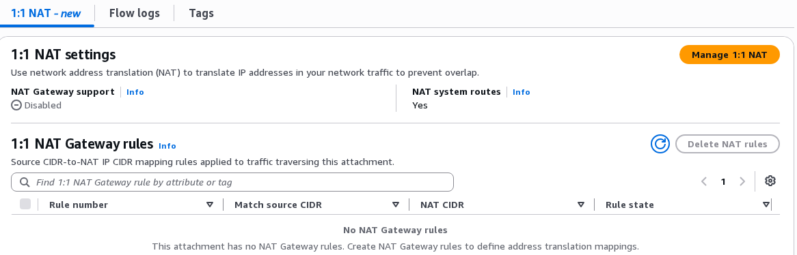{ .shot }

3. 아래처럼 설정합니다.
    - **Enable NAT Gateway support**를 선택합니다. 이 Transit Gateway 연결에서 1:1 NAT를 켜는 설정입니다. 이름에 NAT Gateway가 들어가지만 VPC의 NAT 게이트웨이와는 관계가 없습니다. 선택하면 아래에 빈 규칙 줄이 하나 생깁니다.
    - **NAT system routes**는 선택된 채로 둡니다. NAT 대역 경로를 Transit Gateway가 알아서 만듭니다. 무엇인지는 아래 설명 상자에 있습니다.
    - 생긴 규칙 줄에 **Rule number** `100`, **Source CIDR** `172.20.N.0/24`, **NAT CIDR** `100.64.1.0/24`를 넣습니다. 입력란 아래에 목록이 뜨면 **Use "…"** 를 고릅니다. **Add rule**은 누르지 않습니다.

    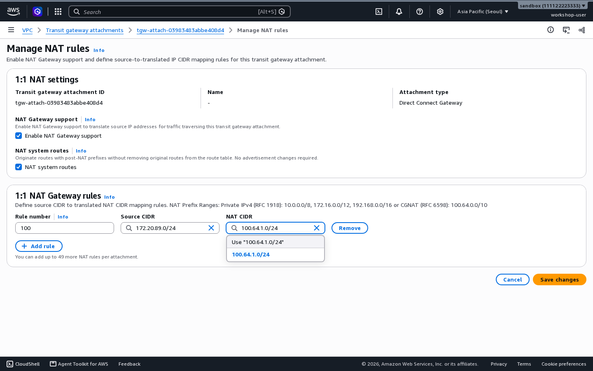{ .shot }

4. **Save changes**를 누릅니다.

빈 규칙 줄이 남아 있으면 `Rule number is required.` 같은 오류가 나고 저장되지 않습니다. **Add rule**을 눌러 줄이 더 생겼다면 빈 줄의 **Remove**를 누르세요.

!!! info "NAT system routes는 무엇인가요?"
    **왜 경로가 하나 더 필요한가요?**

    1. NAT를 켜면 온프레미스 VM(`vmN`, `172.20.N.10`)은 AWS 쪽에서 새 주소 `100.64.1.10`으로 보입니다.
    2. 그래서 VPC-A EC2가 온프레미스 VM에게 보내는 패킷은 받는 주소가 `100.64.1.10`입니다. 온프레미스 VM이 보낸 요청에 대한 응답도 같습니다.
    3. 패킷이 Transit Gateway에 오면, Transit Gateway는 라우팅 테이블에서 `100.64.1.10`으로 가는 길을 찾습니다.
    4. `100.64.1.0/24`는 NAT 규칙에서 새로 정한 대역입니다. 온프레미스 라우터(`rtN`)는 이 대역을 광고하지 않습니다. 경로가 없으면 Transit Gateway는 패킷을 어디로 보낼지 몰라 버립니다.

    그래서 "`100.64.1.0/24`는 DXGW(Direct Connect gateway) 연결(온프레미스 쪽)로 보내라"는 경로가 있어야 합니다.

    **NAT system routes는 이 경로를 누가 만들지 정합니다.** 주소를 바꾸는 일과는 상관없습니다. 주소 변환은 **Enable NAT Gateway support**와 규칙이 정합니다. 공식 문서와 API에서는 이 설정을 NAT system route support(`NatSystemRouteSupport`)라고 부릅니다.

    | 설정 | NAT 대역 경로를 만드는 쪽 | 라우팅 테이블의 유형 |
    |---|---|---|
    | 켬 (기본값, 이 실습) | Transit Gateway가 자동으로 만듦 | **System** |
    | 끔 | 온프레미스 라우터가 BGP(Border Gateway Protocol)로 광고하거나, 정적 경로를 직접 추가 | **Propagated**(정적 경로면 **Static**) |

    켜 두었을 때 알아 둘 점이 있습니다.

    - 이 경로는 온프레미스가 원래 대역(`172.20.N.0/24`)과 겹치는 경로를 광고하는 동안만 **Active**입니다. 광고가 멈추면 **Blackhole**이 되고, NAT 대역으로 가는 패킷이 버려집니다. 겹치는 경로에는 같은 대역, 그 안의 더 작은 대역, 그것을 포함하는 요약 경로가 모두 해당합니다.
    - 경로는 이 연결이 **전파(propagation)하는 라우팅 테이블**에만 생깁니다. 다른 라우팅 테이블에서 NAT 대역에 가려면 정적 경로를 직접 추가해야 합니다.
    - 같은 대역의 경로가 여럿이면 정적(Static) > System > 접두사 목록(Prefix list) > Propagated 순서로 쓰입니다. 직접 만든 정적 경로가 있으면 NAT 경로보다 먼저 쓰입니다.

??? note "연결 종류(Attachment Type)별 NAT system routes 설정"
    NAT system routes를 고를 수 있는 연결은 Direct Connect gateway 연결과 BGP를 쓰는 Site-to-Site VPN 연결뿐입니다.

    설정을 끄고 NAT 대역을 직접 광고하면, BGP 속성으로 두 회선을 Active-Passive나 Active-Active로 쓰도록 조정할 수 있습니다. 직접 해 보는 방법은 [추가 과제 3-2](extra-b.md)에 있습니다.

    | 연결 종류 | NAT system routes | NAT 대역 경로를 만드는 쪽 | 라우팅 테이블의 유형 |
    |---|---|---|---|
    | VPC | 항상 켬(바꿀 수 없음) | Transit Gateway. 규칙의 원래 대역이 VPC 대역과 **똑같을 때만** 만들고, 그 VPC 대역 경로는 지움 | **System** |
    | Direct Connect gateway, Site-to-Site VPN(BGP) | 켬(기본값, 이 실습) | Transit Gateway | **System** |
    | Direct Connect gateway, Site-to-Site VPN(BGP) | 끔 | 온프레미스 라우터가 BGP로 광고하거나, 정적 경로를 직접 추가 | **Propagated** 또는 **Static** |
    | Transit Gateway 피어링, Site-to-Site VPN(정적 라우팅) | 항상 끔 | 정적 경로를 직접 추가 | **Static** |
    | Connect, VPN Concentrator | 항상 끔 | BGP 피어가 광고하거나, 정적 경로를 직접 추가 | **Propagated** 또는 **Static** |

    VPC 연결에서 규칙의 원래 대역이 VPC 대역과 다르면(예: `/16` VPC 안의 `/24`) 주소는 바뀌지만 경로는 생기지 않습니다. 그러면 NAT 주소로 오는 패킷(응답 포함)이 VPC로 가지 못합니다. 이때는 NAT 대역 정적 경로를 직접 추가해야 합니다.

**성공 확인**: **1:1 NAT** 탭에 **NAT Gateway support: Enabled**, 규칙 상태 **Activated**가 보입니다(사전 테스트 시 30초 안). **Enabling**이면 잠시 뒤 새로 고칩니다.

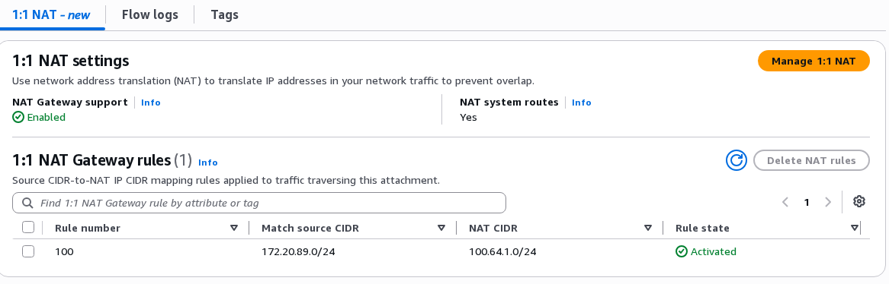{ .shot }

## 2-3-5. VPC-A 연결에 규칙 넣기 { #lab2-5 }

VPC-A 주소 `172.20.N.0/24`가 밖에서 `100.64.2.0/24`로 보이게 합니다.

1. **Transit gateway attachments**에서 이름이 `tgwnat-attach-vpc-a`인 연결을 누릅니다.
2. 2-3-4와 같은 방법으로 **Enable NAT Gateway support**를 선택하고, 자동으로 생긴 규칙 줄에 `100`, `172.20.N.0/24` → `100.64.2.0/24`를 넣어 저장합니다.

VPC 연결에서는 **NAT system routes**가 항상 켜져 있어 바꿀 수 없습니다. 이번 규칙의 원래 대역 `172.20.N.0/24`는 VPC-A 대역과 똑같습니다. 그래서 Transit Gateway는 VPC-A의 원래 경로(`172.20.N.0/24` → VPC-A)를 지우고, `100.64.2.0/24` **System** 경로를 대신 만듭니다. 온프레미스가 광고한 `172.20.N.0/24` 경로는 그대로 남습니다. 대역이 다를 때와 DXGW 연결과의 차이는 [2-3-4의 접힌 설명](#lab2-4)에 있습니다.

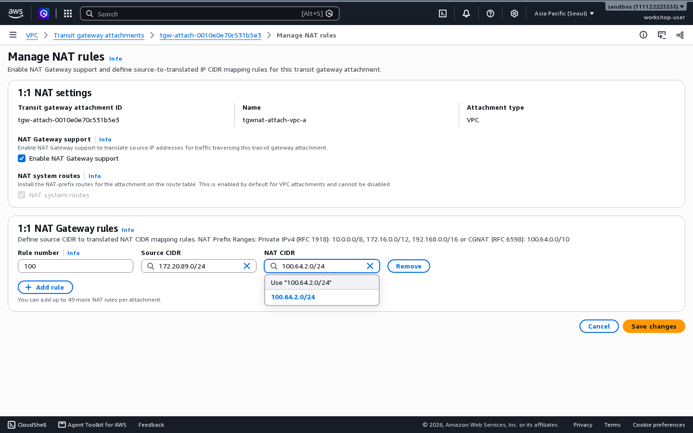{ .shot }

**성공 확인**: 이 연결도 **Enabled**, **Activated**가 됩니다.

## 2-3-6. 라우팅 테이블 다시 보기 { #lab2-6 }

**Transit gateway route tables** → [2-2-7](lab1.md#lab1-7)에서 연 라우팅 테이블 ID → **Routes** 탭을 엽니다.

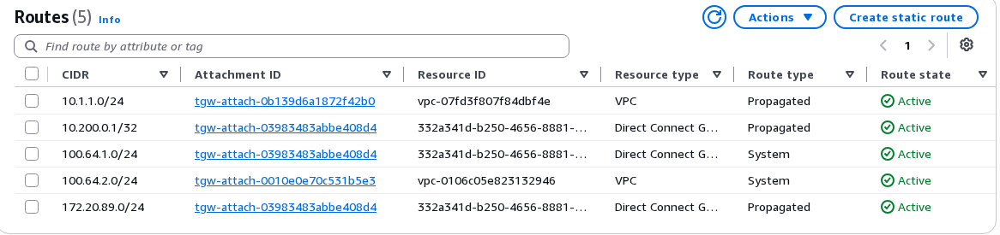{ .shot }

| 경로 | 가는 곳 | 유형 | 설명 |
|---|---|---|---|
| `100.64.1.0/24` | Direct Connect Gateway | **System** | 온프레미스의 NAT 대역. NAT system routes가 켜져 있어 Transit Gateway가 만듦 |
| `100.64.2.0/24` | VPC | **System** | VPC-A의 NAT 대역. VPC-A의 원래 경로를 대신함 |
| `172.20.N.0/24` | Direct Connect Gateway | Propagated | VPC-A 경로가 빠져서, 온프레미스가 광고한 경로가 보임 |

스택은 VPC 라우팅 테이블과 보안 그룹에 NAT 대역을 미리 넣어 두었습니다. VPC-A EC2는 온프레미스를 `100.64.1.0/24`로 보기 때문입니다.

## 2-3-7. 통신해 보기 { #lab2-7 }

패킷이 지나가며 주소가 이렇게 바뀝니다.

<figure markdown="span">
  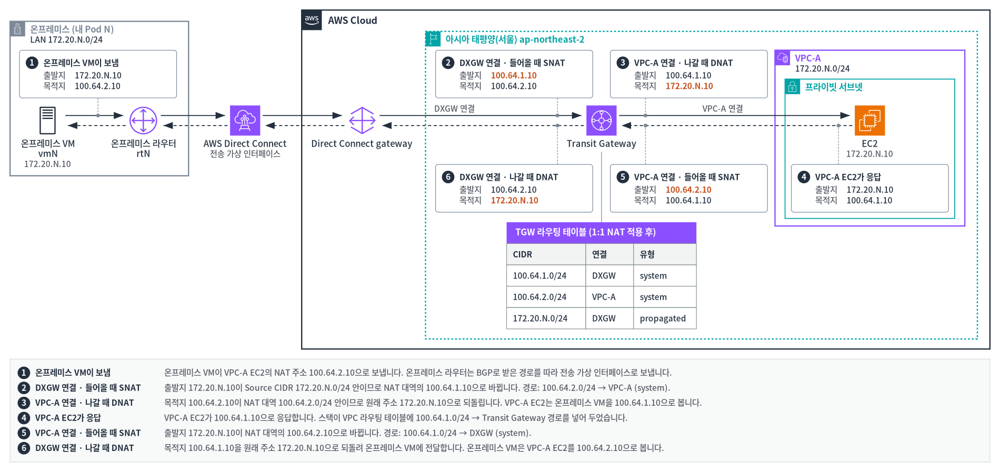
  <figcaption>그림 6. NAT 적용 후 패킷 흐름</figcaption>
</figure>

그림 6이 작게 보이면 [원본 크기로 보기](images/diagrams/lab2-packet-walk.png)를 누릅니다.

| 번호 | 지점 | 내용 |
|---|---|---|
| 1 | 온프레미스 VM이 보냄 | 온프레미스 VM이 VPC-A EC2의 NAT 주소 `100.64.2.10`으로 보냅니다. 온프레미스 라우터는 [2-2-2](lab1.md#lab1-2)의 허용된 접두사(Allowed prefixes)로 받은 `100.64.2.0/24` 경로를 따라 보냅니다. |
| 2 | DXGW 연결 · 들어올 때 SNAT(Source Network Address Translation) | 출발지 `172.20.N.10`이 Source CIDR `172.20.N.0/24` 안이므로 NAT 대역의 `100.64.1.10`으로 바뀝니다. 경로: `100.64.2.0/24` → VPC-A (system). |
| 3 | VPC-A 연결 · 나갈 때 DNAT(Destination Network Address Translation) | 목적지 `100.64.2.10`이 NAT 대역 `100.64.2.0/24` 안이므로 원래 주소 `172.20.N.10`으로 되돌립니다. VPC-A EC2는 온프레미스 VM을 `100.64.1.10`으로 봅니다. |
| 4 | VPC-A EC2가 응답 | VPC-A EC2가 `100.64.1.10`으로 응답합니다. 스택이 VPC 라우팅 테이블에 `100.64.1.0/24` → Transit Gateway 경로를 넣어 두었습니다. |
| 5 | VPC-A 연결 · 들어올 때 SNAT | 출발지 `172.20.N.10`이 NAT 대역의 `100.64.2.10`으로 바뀝니다. 경로: `100.64.1.0/24` → DXGW (system). |
| 6 | DXGW 연결 · 나갈 때 DNAT | 목적지 `100.64.1.10`을 원래 주소 `172.20.N.10`으로 되돌려 온프레미스 VM에 전달합니다. 온프레미스 VM은 VPC-A EC2를 `100.64.2.10`으로 봅니다. |

**온프레미스 → VPC-A**

온프레미스 VM(`vmN`) 터미널에서 실행합니다. 네 명령은 차례로 연결, 출발지 주소 변환, 보조 주소 매핑, 포트 보존을 확인합니다. 스택은 VPC-A EC2에 보조 주소 `172.20.N.20`도 미리 넣어 두었습니다. 라우터 인터페이스에서는 흔하지 않지만, EC2는 네트워크 인터페이스 하나에 같은 서브넷의 사설 IP를 여러 개 붙일 수 있습니다(보조 사설 IP). 따로 설정할 것은 없습니다.

```bash
ping -c 5 100.64.2.10
curl http://100.64.2.10:8080/
ping -c 3 100.64.2.20
curl --local-port 40000 http://100.64.2.10:8080/
```

**성공 확인**

- ping이 모두 성공합니다.
- `curl` 응답이 `vpc-a-ec2 saw 100.64.1.10:<포트>`입니다. VPC-A는 온프레미스 VM을 **`100.64.1.10`** 으로 봅니다.
- `100.64.2.20`은 VPC-A EC2의 보조 주소 `172.20.N.20`으로 갑니다. 마지막 숫자는 그대로입니다.
- `--local-port 40000`으로 보내면 `saw 100.64.1.10:40000`입니다. 포트도 그대로입니다.

**VPC-A → 온프레미스**

1. 온프레미스 VM(`vmN`) 터미널에서 웹 서버를 백그라운드로 실행합니다. 이 웹 서버는 접속해 온 상대의 주소를 이 터미널에 기록합니다. 명령 끝의 `&`는 백그라운드 실행을 뜻합니다. 그래서 서버가 도는 동안에도 같은 터미널에서 다른 명령을 입력할 수 있습니다.

    ```bash
    pkill -f 'http.server 8080'; python3 -m http.server 8080 &
    ```

    앞의 `pkill`은 전에 띄운 웹 서버가 남아 있으면 끕니다. 웹 터미널이 끊겼다가 다시 열리면, 전에 띄운 서버가 포트를 잡은 채 응답하지 못하기 때문입니다.

2. VPC-A EC2 터미널에서 온프레미스의 NAT 주소로 보냅니다.

    ```bash
    ping -c 4 100.64.1.10
    curl -s -o /dev/null -w 'HTTP %{http_code}\n' http://100.64.1.10:8080/
    ```

    이 `curl`은 온프레미스 VM의 웹 서버에 요청을 보내고 HTTP 상태 코드만 한 줄로 보여 줍니다. `-s`는 진행 표시와 오류 메시지를 숨기고, `-o /dev/null`은 응답 본문을 버리고, `-w 'HTTP %{http_code}\n'`은 상태 코드를 출력합니다. `HTTP 200`이면 요청이 도착하고 응답이 돌아온 것입니다. 주소가 바뀌었는지는 아래처럼 웹 서버 기록의 출발지 주소로 확인합니다.

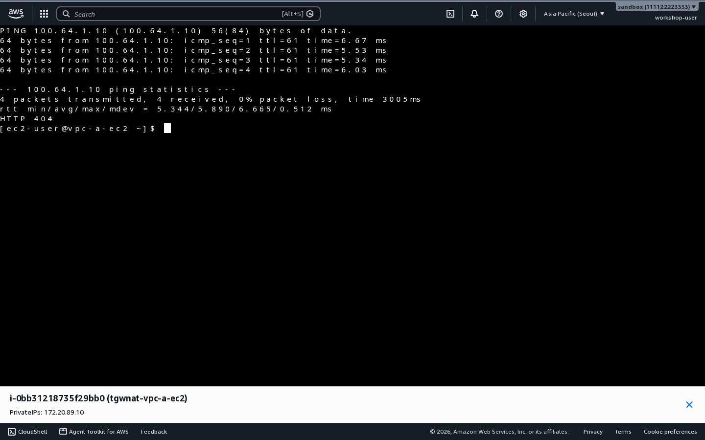{ .shot }

**성공 확인**: VPC-A EC2 터미널에는 `HTTP 200`이 보입니다. 온프레미스 VM 터미널에는 웹 서버 기록이 찍히는데, 맨 앞 주소가 **`100.64.2.10`** 입니다. 온프레미스는 VPC-A EC2를 `100.64.2.10`으로 봅니다. AWS 쪽에서 먼저 보내도 똑같이 동작합니다.

백그라운드로 실행한 온프레미스 VM의 웹 서버는 `kill %1`로 멈춥니다.

??? note "(선택) UDP로도 확인하기"
    온프레미스 VM(`vmN`) 터미널에서 VPC-A EC2의 UDP(User Datagram Protocol) 9000번으로 보냅니다.

    ```bash
    (echo hello; sleep 1) | nc -u -w 2 100.64.2.10 9000; echo
    ```

    응답이 `vpc-a-ec2 saw 100.64.1.10:<포트> hello`이면 UDP도 같은 방식으로 바뀐 것입니다.

    사전 테스트 때 실제로 나온 출력입니다(Pod 89). 보낸 글자(`hello`)가 응답 끝에 그대로 붙습니다. 포트 번호는 매번 다릅니다.

    ```text
    labuser@vm89:~$ (echo hello; sleep 1) | nc -u -w 2 100.64.2.10 9000; echo
    vpc-a-ec2 saw 100.64.1.10:53541 hello
    ```

    VPC-A EC2는 온프레미스 VM을 UDP에서도 `100.64.1.10`으로 봅니다. TCP(Transmission Control Protocol, `curl`)와 같습니다.

## 2-3-8. 정리 { #lab2-summary }

| 확인한 것 | 결과 |
|---|---|
| NAT 전 | 온프레미스 VM(`vmN`) → VPC-B 응답이 VPC-A로 감. 온프레미스 VM → VPC-A는 갈 방법이 없음 |
| NAT 후 | 같은 주소를 쓰는 온프레미스 VM과 VPC-A EC2가 서로를 `100.64.2.10`, `100.64.1.10`으로 보고 통신 |
| 1:1 매핑 | 호스트 부분(이 실습은 마지막 숫자 .10, .20)과 포트(40000)는 그대로 |
| 라우팅 | NAT 대역 경로는 Transit Gateway가 **System** 경로로 만듦 |

[2-3-2](#lab2-2)에서 실패한 온프레미스 VM → VPC-B 통신도 이제 됩니다. DXGW 연결이 출발지를 `100.64.1.10`으로 바꾸므로, VPC-B의 응답이 VPC-A로 가지 않고 온프레미스 VM으로 돌아옵니다. VPC-B 연결에는 규칙이 없어도 됩니다. 확인하는 방법은 [추가 과제 3-1-1](extra-a.md#a1)에 있습니다.

더 해 보고 싶다면 [추가 과제](extra-a.md)를 하세요. 마지막에는 [리소스 정리](extra-d.md)를 합니다.
