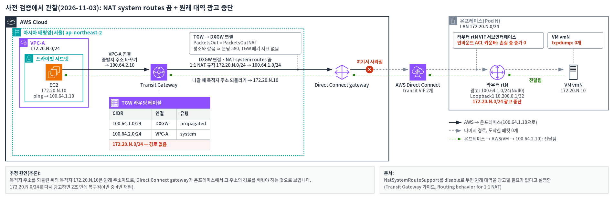

# 사전 검증에서 관찰한 동작

공식 문서와 다르게 동작한 것을 관찰한 기록입니다. 워크숍에서는 이 동작을 직접 재현하지 않습니다.

## NAT system routes를 끄고 원래 대역 광고를 멈추면 { #disable-withdraw }

### 문서 설명 { #doc }

[Routing behavior for 1:1 NAT](https://docs.aws.amazon.com/vpc/latest/tgw/tgw-nat-routing.html)의 "Direct Connect gateway and BGP Site-to-Site VPN attachments" 절은 이렇게 설명합니다.

> With `NatSystemRouteSupport` set to `disable`, your network no longer needs to advertise the original CIDR. If the original CIDR overlaps another attachment's CIDR, stop advertising it once you advertise the NAT CIDR …

[How 1:1 NAT works](https://docs.aws.amazon.com/vpc/latest/tgw/tgw-nat-how-it-works.html)도 끈 경우 원래 대역 **대신** NAT 대역을 광고하라고 설명합니다. 이 워크숍처럼 온프레미스와 VPC가 같은 대역을 쓰는 경우가 바로 여기에 해당합니다.

### 관찰한 것 { #observed }

조건: 2026-11-03, 서울 리전, DXGW 연결, 같은 파트너의 50Mbps hosted connection 2개, 라우터 Cisco IOS XE 16.12, Pod 1개.

- NAT system routes를 끄고 라우터가 NAT 대역(`100.64.1.0/24`)을 광고하는 상태에서, 원래 대역 광고를 멈췄습니다.
- 그러자 **AWS → 온프레미스** 방향이 끊겼습니다. 온프레미스 → AWS 방향은 계속 전달됐습니다.
- 원래 대역을 다시 광고하면 2초 안에 돌아왔습니다.
- 같은 조건으로 4번 해서 4번 모두 같았습니다. 5분 넘게 기다려도 저절로 돌아오지 않았습니다.

| 횟수 | 원래 대역 광고를 멈춘 시간 | AWS → 온프레미스가 끊긴 시간 |
|---|---|---|
| 1 | 93초 | 94.1초 |
| 2 | 252초 | 253.9초 |
| 3 | 137초 | 138.1초 |
| 4 | 319초 | 320.0초 |

### 어디서 사라졌나 { #where }

2~4번째에 라우터와 VM에서 직접 확인했습니다.

| 지점 | 끊긴 동안 |
|---|---|
| Transit Gateway → DXGW 연결 | 주소를 바꾼 패킷이 평소처럼 나감(`PacketsOut` = `PacketsOutNAT`, 분당 약 580). Transit Gateway가 버린 기록은 없음 |
| 라우터 도착 | 늘어나지 않음(라우터의 인바운드 ACL 카운터, NAT 주소·원래 주소 모두) |
| VM 도착 | 0개(VM 패킷 캡처, 2·3번째) |

Transit Gateway는 패킷을 DXGW 연결로 내보냈지만, 라우터에는 닿지 않았습니다. 되돌린 목적지는 원래 주소(`172.20.N.10`)입니다. 그래서 Direct Connect gateway가 온프레미스에게서 그 주소의 경로를 배워야 전달할 수 있는 것으로 보입니다(추론). Direct Connect gateway 안은 직접 볼 수 없었습니다.

## 워크숍에서의 안내 { #guide }

- NAT system routes를 끄더라도 라우터는 **원래 대역(또는 그것을 포함하는 요약 경로) 광고를 계속 유지**합니다.
- 이 동작은 문서 피드백과 AWS Support로 확인을 요청할 예정입니다. 결과가 나오면 이 페이지를 고칩니다.
