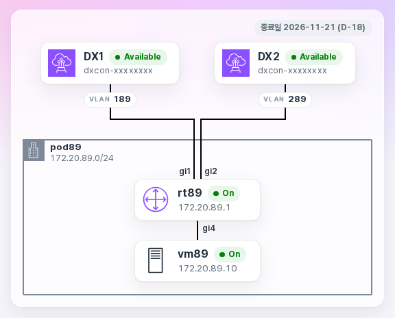

# 1-2. 사전 준비

## 1-2-1. 받는 것

워크숍 운영자가 참가자마다 다음을 준비해 둡니다.

| 항목 | 내용 |
|---|---|
| AWS 계정 | 실습용 계정 1개와 콘솔 로그인 정보 |
| 온프레미스 Pod | 온프레미스 라우터(`rtN`, Cisco)와 온프레미스 VM(Virtual Machine, `vmN`, Linux). 온프레미스 대역은 `172.20.N.0/24` |
| [hosted connection](glossary.md#1-3-1) 2개 | Direct Connect 파트너가 만들어 여러분 계정에 넘겨 준 회선입니다. 처음에는 **Ordering**(수락 대기) 상태입니다 |
| 실습 장비 페이지 | 내 Pod 정보를 보고, 온프레미스 라우터와 온프레미스 VM의 터미널을 여는 페이지(링크는 운영자가 드립니다) |

hosted connection 2개는 [실습 2-1](lab0.md#lab0-2)에서 수락합니다. 그다음 [실습 2-2](lab1.md)에서 연결마다 전송 가상 인터페이스를 하나씩 만듭니다.

실습 장비 페이지는 아래처럼 보입니다. hosted connection 2개(DX1, DX2)와 각각의 VLAN(Virtual LAN), 내 온프레미스 라우터와 온프레미스 VM이 보입니다.

{ .shot }

그림은 사전 테스트(Pod 89) 때 찍은 화면이라 DX1·DX2 옆에 **Available**이 보입니다. 내 계정에서 hosted connection을 수락했는지는 이 페이지가 아니라 Direct Connect 콘솔의 **Connections**에서 확인합니다. 실습을 시작할 때 콘솔의 상태는 **Ordering**입니다.

## 1-2-2. 내 값 적어 두기 { #notes }

실습에서 계속 쓰는 값입니다. 미리 적어 두면 편합니다.

| 값 | 예 | 찾는 곳 |
|---|---|---|
| Pod 번호 N | `89` | 실습 장비 페이지(`podN`) |
| DX1 VLAN | `189` | 실습 장비 페이지 |
| DX2 VLAN | `289` | 실습 장비 페이지 |
| 전송 가상 인터페이스의 **Your router peer IP** | `169.254.96.54/29` | [실습 2-2-4](lab1.md#lab1-4)에서 인터페이스 상세의 **Peerings** 탭 |
| 전송 가상 인터페이스의 **Amazon router peer IP** | `169.254.96.49/29` | 위와 같음 |
| 전송 가상 인터페이스의 **BGP authentication key** | AWS가 만든 문자열 | 위와 같음 |

전송 가상 인터페이스의 세 값은 인터페이스 2개마다 따로 적습니다. 예는 Pod 89의 첫 번째 인터페이스 값입니다. 인터페이스를 만든 뒤에 생기는 값이므로 지금은 비워 둡니다.

## 1-2-3. 브라우저 준비

- 따로 설치할 프로그램은 없습니다. 콘솔, 웹 터미널, VPC-A EC2와 VPC-B EC2 접속 모두 브라우저에서 합니다.
- 콘솔 언어를 **English**로 바꾸면 이 안내와 화면이 같습니다. 콘솔 오른쪽 위 톱니바퀴 아이콘(**Unified Settings**) → **Language**에서 바꿉니다.
- 콘솔 오른쪽 위 리전을 **Asia Pacific (Seoul)** 로 맞춥니다. Direct Connect 콘솔에는 **Global**로 보이지만 괜찮습니다.

## 1-2-4. 꼭 지켜 주세요

!!! danger "hosted connection은 지우지 마세요"
    콘솔에서 지울 수는 있지만, 지우면 여러분이 다시 만들 수 없습니다. 실습이 끝나도 그대로 두세요. 운영자가 회수합니다.

!!! warning "온프레미스 라우터(`rtN`)의 GigabitEthernet4는 건드리지 마세요"
    실습 장비 페이지 그림의 `gi4`가 `GigabitEthernet4`입니다(`gi1`, `gi2`는 `GigabitEthernet1`, `GigabitEthernet2`). `GigabitEthernet4`는 온프레미스 대역(`172.20.N.0/24`)과 웹 터미널이 연결되는 인터페이스입니다. 실습에서는 `GigabitEthernet1`, `GigabitEthernet2`에 설정을 추가하기만 합니다.

## 1-2-5. 비용

실습 계정에 다음 요금이 발생합니다. 계정과 비용은 운영자가 관리합니다.

- hosted connection 2개의 포트 요금(수락한 때부터 운영자가 회수할 때까지)과 Direct Connect 데이터 전송
- Transit Gateway 연결 3개의 시간당 요금과 데이터 처리
- EC2 2대(VPC-A EC2, VPC-B EC2), CloudWatch Logs 저장과 조회
- 1:1 NAT(Network Address Translation) 기능 자체의 요금은 확인 중입니다
