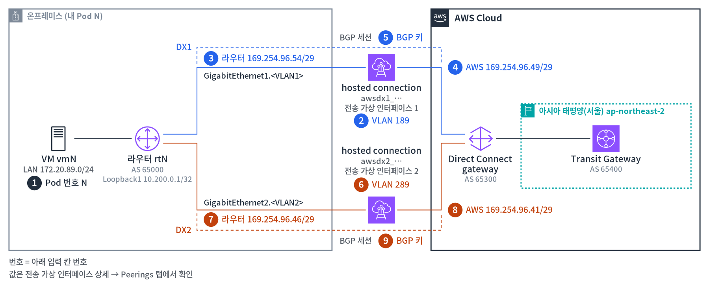

# 라우터 설정 생성기

[실습 1-4](lab1.md#lab1-4)에서 적은 값을 넣으면 라우터에 붙여 넣을 설정이 만들어집니다. 값은 이 브라우저 안에서만 쓰이고 어디로도 보내지지 않습니다.

## 값이 쓰이는 곳 { #map }

그림의 번호는 아래 입력 칸의 번호와 같습니다. 위쪽 회선이 **DX1**, 아래쪽 회선이 **DX2**입니다.

## 값 넣기 { #form }

DX1 값은 `tgw-nat-vif1`, DX2 값은 `tgw-nat-vif2`의 **Peerings** 탭에서 가져옵니다. 피어 IP는 `/29`를 붙인 채로 넣어도 됩니다.

  <fieldset class="gen-group gen-common">
    <legend>공통</legend>
    <label>1Pod 번호 N<small>실습 장비 페이지의 podN</small><input id="g-pod" inputmode="numeric" placeholder="89"></label>
  </fieldset>
  <fieldset class="gen-group gen-dx1">
    <legend>DX1 · <code>awsdx1_…</code> · <code>tgw-nat-vif1</code> · 라우터 GigabitEthernet1</legend>
    <label>2VLAN<input id="g-vlan1" inputmode="numeric" placeholder="189"></label>
    <label>3Your router peer IP<small>라우터 쪽 IP</small><input id="g-my1" placeholder="169.254.96.54/29"></label>
    <label>4Amazon router peer IP<small>AWS 쪽 IP</small><input id="g-aws1" placeholder="169.254.96.49/29"></label>
    <label>5BGP authentication key<input id="g-key1" autocomplete="off" spellcheck="false"></label>
  </fieldset>
  <fieldset class="gen-group gen-dx2">
    <legend>DX2 · <code>awsdx2_…</code> · <code>tgw-nat-vif2</code> · 라우터 GigabitEthernet2</legend>
    <label>6VLAN<input id="g-vlan2" inputmode="numeric" placeholder="289"></label>
    <label>7Your router peer IP<small>라우터 쪽 IP</small><input id="g-my2" placeholder="169.254.96.46/29"></label>
    <label>8Amazon router peer IP<small>AWS 쪽 IP</small><input id="g-aws2" placeholder="169.254.96.41/29"></label>
    <label>9BGP authentication key<input id="g-key2" autocomplete="off" spellcheck="false"></label>
  </fieldset>

## 만들어진 설정 { #output }

줄 앞의 번호는 그 줄에 들어간 값입니다. 입력 칸을 누르면 그 값이 들어가는 줄이 강조됩니다. 번호는 복사되지 않습니다.

<button id="g-copy" class="md-button md-button--primary" type="button">복사</button> 

<pre id="g-out" class="gen-out"></pre>

## 넣는 값 { #inputs }

| 번호 | 값 | 찾는 곳 |
|---|---|---|
| 1 | Pod 번호 N | 실습 장비 페이지(`podN`) |
| 2, 6 | VLAN | 실습 장비 페이지, 또는 전송 가상 인터페이스 상세의 **VLAN** |
| 3, 7 | Your router peer IP | 전송 가상 인터페이스 상세 → **Peerings** 탭 |
| 4, 8 | Amazon router peer IP | 전송 가상 인터페이스 상세 → **Peerings** 탭 |
| 5, 9 | BGP authentication key | 전송 가상 인터페이스 상세 → **Peerings** 탭 |

DX1(2–5)은 `awsdx1_…` 위에 만든 `tgw-nat-vif1`, DX2(6–9)는 `awsdx2_…` 위에 만든 `tgw-nat-vif2`의 값입니다. 두 인터페이스의 값을 섞으면 BGP가 올라오지 않습니다. 생성기는 같은 인터페이스의 두 피어 IP가 같은 `/29`에 있는지 확인해 알려 줍니다.

## 설정이 하는 일 { #explain }

| 부분 | 쓰는 값 | 하는 일 |
|---|---|---|
| `GigabitEthernet1.<VLAN1>`, `GigabitEthernet2.<VLAN2>` | 2·3, 6·7 | 전송 가상 인터페이스마다 하나씩 만드는 서브인터페이스. VLAN 번호와 라우터 쪽 IP, 회선 끊김을 빨리 알아채는 BFD를 설정 |
| `Loopback1` `10.200.0.1/32` | — | NAT 규칙에 없는 주소. 주소가 바뀌지 않는 경우를 확인할 때 씀 |
| `neighbor … remote-as 65300` | 4·5, 8·9 | Direct Connect gateway(AS 65300)와 BGP로 경로를 주고받음. BGP 키와 BFD를 함께 씀 |
| `network 172.20.N.0 …`, `network 10.200.0.1 …` | 1 | 온프레미스 LAN과 Loopback1을 AWS에 광고 |
| `maximum-paths 2` | — | 두 전송 가상 인터페이스로 받은 같은 경로를 함께 씀(ECMP) |
